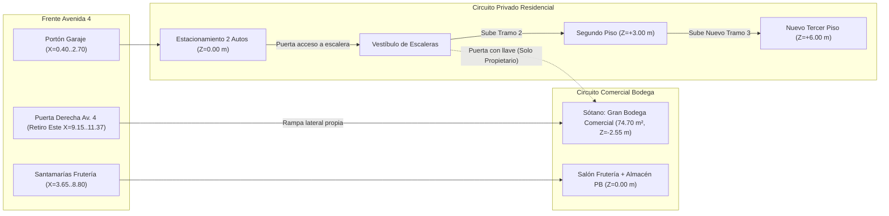

# Plan Maestro: Ampliación a 3 Pisos + Sótano Bodega Comercial (`casa_proyecto_3_pisos.dxf`)

> [!IMPORTANT]
> **Respeto a los archivos actuales:** El modelo existente [`casa_nuevo_proyecto.dxf`](file:///c:/Users/alvar/Documents/casa/02_Modelos_CAD/casa_nuevo_proyecto.dxf) y su generador [`build_nuevo_proyecto.py`](file:///c:/Users/alvar/Documents/casa/04_Scripts_Parametricos/build_nuevo_proyecto.py) permanecerán **100% intactos**. Todo este rediseño se generará en un nuevo archivo independiente (`02_Modelos_CAD/casa_proyecto_3_pisos.dxf` mediante `04_Scripts_Parametricos/build_casa_3_pisos.py`) una vez aprobado este plan.

---

## 1. Diagnóstico Bioclimático de la Parcela (Luz Solar y Ventilación Cruzada)

A partir del levantamiento U.T.M. oficial de la propiedad en Independencia, Estado Yaracuy (`Lat. ~10°20' N`), cada fachada tiene un comportamiento ambiental muy definido que guía dónde ubicar salas, cocinas, baños y dormitorios:

| Fachada | Orientación Real | Condición de Lindero | Comportamiento de Luz y Viento | Uso Óptimo Recomendado |
| :--- | :--- | :--- | :--- | :--- |
| **Lateral Derecha (`X = 9,15 m`, `21,71 m` largo)** | **Noreste (`N 58° E`)** | Retiro propio libre (`1,65 m` a `2,22 m`) | **Fachada privilegio:** Recibe los **vientos alisios dominantes** y el sol fresco de la mañana; queda en sombra toda la tarde. | Dormitorios principales/secundarios, salón social, estudio y comedor. |
| **Frontal Av. 4 (`Y = 21,71 m`, `9,00 m` ancho)** | **Noroeste (`N 32° W`)** | Calle pública abierta | Excelente luz diurna y brisa urbana; sol de media tarde fácilmente controlable con balcones techados de `1,96 m`. | Terrazas techadas, gran sala social (P2) y Master Suite Penthouse (P3). |
| **Posterior Patio (`Y = 0,00 m`, `9,00 m` ancho)** | **Sureste (`S 32° E`)** | Patio propio (`3,00 m` de fondo) | Sol suave matutino y **zona natural de succión de brisa** (completa el túnel de viento Norte–Sur y Este–Sur). | Ventanales de desfogue térmico, terraza mirador sur, lavandería y dormitorio esquinero. |
| **Lateral Izquierda (`X = 0,15 m`, `21,71 m` largo)** | **Suroeste (`S 32° W`)** | **Medianera ciega** (*Casa de Mario Graterol*) | **Cero ventanas permitidas** (`0,00 m` invasión). Alta carga térmica vespertina amortiguada por muro doble. | Escaleras, vestieres, despensas, muebles de cocina y **pozo de luz cenital**. |

> [!TIP]
> **La clave del éxito al subir a 3 pisos:** En el modelo anterior de 2 pisos, toda la fachada larga Noreste (`21,71 m`) estaba ocupada por habitaciones cerradas, dejando la Sala y el Comedor sin brisa directa del Este. Al contar ahora con **Segundo Piso (`195,39 m²`) + Nuevo Tercer Piso (`195,39 m²`)**, podemos separar la **Planta de Día / Social (Piso 2)** de la **Planta de Noche / Dormitorios (Piso 3)** y sumarle una **Claraboya Ventilada sobre la Escalera Central**, logrando **ventilación cruzada real en el 100% de los ambientes**.

---

## 2. Sótano (`Z = -2,55 m`) y Control de Accesos en Planta Baja (`Z = ±0,00 m`)

### 2.1 Transformación del Sótano: De Taberna a Gran Bodega Comercial (`74,70 m²` + Patio de Carga)
Se retiran por completo la cava de vinos, el cine, la barra húmeda, la suite de huéspedes y la pérgola residencial para crear un **Centro de Acopio Mayorista para la Zona Comercial**:

1. **Acceso Comercial Único por la Puerta Derecha de la Avenida 4 (`X = 9,15..11,37 m`):**
   * En el retiro lateral derecho del frente sobre Avenida 4 (`2,22 m` de ancho propio entre el local comercial y el lindero `P-2`), se instala un **Portón / Puerta de Seguridad Comercial**.
   * El corredor lateral derecho (`X = 9,15..10,80 m`) se acondiciona como **Rampa Logística Continua Antideslizante** (pendiente suave apta para carretillas/zorras de carga) que desciende desde `Z = 0,00 m` hasta `Z = -2,55 m` y entra directo a la Bodega por un **Portón Doble de Carga (`2,20 × 2,10 m`)** en la esquina Sureste.
2. **Distribución Interna de la Nueva Bodega (`9,00 × 8,30 m`):**
   * **Nave Central y Norte de Racks Pesados (`~44 m²`):** Sin tabiques intermedios (conservando intactas las columnas de `35 × 35 cm`). Baterías de estanterías metálicas industriales de 4 niveles y área de pallets/sacos aprovechando la frescura natural de los muros de contención Norte y Oeste.
   * **Cámara de Pre-Frío / Maduración Mayorista (`Noroeste, ~11,5 m²`):** Recinto isotérmico opcional para maduración controlada (plátanos, aguacates, cítricos) o reserva refrigerada de gran volumen.
   * **Zona de Recepción, Pesaje de Plataforma y Despacho (`Sureste, ~12 m²`):** Junto al portón doble exterior, con báscula industrial de piso (`500 kg`), mesa de control de guías/inventario y patio pavimentado trasero de maniobra.
   * **Baño Operativo de Personal + Cuarto de Aseo (`Centro-Sur, 1,60 × 2,40 m`):** Compacto sobre el núcleo sanitario existente (WC, lavamanos y poceta lava-mopas) con celosía alta al sur.
   * **Ventilación e Iluminación Segura de Bodega:** Se sustituyen los ventanales bajos residenciales por **ventanas altas basculantes con reja/malla anti-insectos (`antepecho Z = 1,65 m`)** en las fachadas Este y Sur, manteniendo el aire fresco y seco para la mercancía sin restar altura de estanterías en las paredes.

### 2.2 Escaleras Intactas + Esclusa con Puerta de Seguridad (Estacionamiento / 2do Piso)
Se conservan en su posición exacta la **Escalera al Sótano (`X = 0,30..1,40 m`)** y la **Escalera al 2do Piso (`X = 1,55..2,65 m`)**, incorporando el cierre de seguridad solicitado:

* **Vestíbulo Cerrado de Escalera en Planta Baja (`Y = 7,35..8,85 m, X = 0,30..2,75 m`):**
  * **Puerta Peatonal Residencial hacia el Estacionamiento (`X = 1,60..2,55 m, Y = 8,80 m`):** Permite pasar cómodamente desde el estacionamiento hacia la escalera del **2do Piso** (aislando además humos y ruidos del garaje respecto a la casa).
  * **Puerta Metálica con Cerradura en el Arranque de la Escalera a Bodega (`X = 0,35..1,35 m, Y = 7,40 m`) + Puerta Inferior en Sótano (`Y = 4,45 m`):** Crea doble control exclusivo para el propietario. El dueño puede bajar desde el estacionamiento o desde el 2do piso a supervisar la bodega, pero **ningún trabajador o proveedor en la bodega puede subir al estacionamiento ni a la vivienda**; su único ingreso y salida es por la **puerta derecha de la Avenida 4**.



---

## 3. Recomendación de Distribución: Segundo Piso (`+3,00 m`) y Tercer Piso (`+6,00 m`)

Te presento nuestra **Recomendación Principal (Opción A: Vivienda Dúplex Bioclimática)**, diseñada específicamente para exprimir al máximo la luz natural y la ventilación cruzada, seguida de una **Alternativa Funcional (Opción B)** por si prefieres independizar plantas.

### 🌟 OPCIÓN A (RECOMENDADA): Piso 2 Social/Gourmet/Huéspedes + Piso 3 Privado Familiar & Penthouse

#### A.1 Segundo Piso (`Z = +3,00 m` — `195,39 m²`): *Planta de Día con Triple Fachada Abierta*
Al subir los dormitorios familiares al Piso 3, **demolemos la barrera longitudinal Norte-Este** para que el Salón, el Comedor y la Cocina respiren directamente por las fachadas **Norte (Av. 4), Este (Vientos Alisios) y Sur (Patio)**:

```
   AVENIDA 4 (NOROESTE — Y = 21,71 m)
   +-----------------------------------------------------------------------+
   |       GRAN BALCONADA SOCIAL CONTINUA TECHADA (8,70 x 1,96 m)          |
   |       • Sala Lounge Exterior + Comedor Mirador + Jardineras           |
   +===========================[Ventanales Corredizos]=====================+ Y = 19,45
   |                                           |                           |
O  |   GRAN SALA PRINCIPAL CHALET              :   ESTUDIO / HOME OFFICE   | E (Brisa
E  |   • Doble entrada de luz (Norte + Este)   :   ACRISTALADO (Hierro y   | S  Alisios
S  |   • Sofá modular en XL + Muro TV          :   vidrio corredizo para   | T  + Sol de
T  |                                           :   dejar pasar luz y aire) | E  Mañana)
E  | - - - - - - - - - - - - - - - - - - - - - +---------------------------+ Y = 15,20
   |                                           |                           |
M  |   GRAN COMEDOR 8-10 PUESTOS               :   TERRAZA / GALERÍA ESTE  |
E  |   • Conectado visualmente a Sala y Cocina :   O DESAYUNADOR LUMINOSO  |
D  |                                           :   (Gran ventanal al Este  |
I  | - - - - - - - - - - - - - - - - - - - - - :    que ventila la Cocina) | Y = 12,00
A  |                                                                       |
N  |   COCINA GOURMET CON GRAN ISLA CENTRAL (5,55 x 4,50 m)                |
E  |   • Recibe brisa cruzada directa desde el ventanal Este -> Sur        |
R  +-----------------------+-------------------+---------------------------+ Y = 7,40
A  | [SUBE A P3] [LLEGA PB]|                   |   BAÑO SOCIAL COMPLETO    |
   |  NÚCLEO ESCALERAS     |  GALERÍA CENTRAL  |   (Con ducha para visitas |
C  |  (Pozo de Luz Cenital)|  + DESPENSA       |    y ventana al Este)     | Y = 4,45
I  +-----------------------+---------+---------+---------------------------+
E  | LAVANDERÍA Y PLANCHADO          | PATIO / |   HABITACIÓN 4: HUÉSPEDES |
G  | VENTILADO AL SUR                | MIRADOR |   O ADULTO MAYOR (12,5m²) |
A  | (Sin escalera de tanque; secado | SUR     |   • Esquinera Este + Sur  |
   |  natural con brisa cruzada)     | ABIERTO |   • Ventilación cruzada   |
   +---------------------------------+---------+---------------------------+ Y = 0,15
                                   SURESTE (PATIO)
```

* **Por qué funciona extraordinariamente bien el Piso 2:**
  1. **Ventilación Cruzada Total (3 direcciones):** El aire fresco del Noreste entra por el Estudio/Desayunador Este (`X = 9,15 m`), atraviesa sin muros ciegos la Isla de Cocina, el Comedor y la Sala, y sale hacia el Sur (Mirador Posterior) y Noroeste (Balconada Av. 4).
  2. **Comodidad Diaria:** Llegas del estacionamiento con las compras y subes un solo tramo directo a la Cocina y Despensa.
  3. **Accesibilidad:** Incluye **1 Habitación Completa en Piso 2 (`Habitación 4`, Sureste)** con baño completo al lado, ideal para huéspedes (reemplazando la que estaba en el sótano) o personas mayores sin subir al 3er piso.

---

#### A.2 Nuevo Tercer Piso (`Z = +6,00 m` — `195,39 m²`): *Planta Privada Familiar, Master Penthouse y Terraza Mirador*
Construido con **columnas metálicas estructurales negras vistas** y techo inclinado estilo Chalet Alpino con cerchas expuestas y **Claraboya Central Ventilada**:

```
   AVENIDA 4 (NOROESTE — Y = 21,71 m)
   +-----------------------------------+-----------------------------------+
   |   BALCÓN PRIVADO OESTE / LECTURA  |   TERRAZA PRIVADA MASTER SUITE    |
   +===================================+===================================+ Y = 19,45
   |   GRAN VESTIER WALK-IN DOBLE      |                                   |
O  |   (3,80 x 3,50 m = 13,3 m²)       |   DORMITORIO MASTER PENTHOUSE     | E (Brisa
E  |   • En crujía oeste protegida     |   (4,50 x 4,50 m = 20,25 m²)      | S  Alisios
S  |     del calor y rayos UV          |   • Esquinero Norte + Este        | T  + Sol de
T  +-----------------------------------+   • Ventilación cruzada a 90°     | E  Mañana)
E  |   GRAN BAÑO SPA MASTER            |   • Techo alto chalet con vigas   |
   |   • Tina exenta + Ducha doble     |                                   |
M  |   • Ventilación por lucernario    +-----------------------------------+ Y = 14,60
E  +-----------------------------------+                                   |
D  |                                   |   HABITACIÓN SECUNDARIA 2         |
I  |   FAMILY ROOM / SALA DE TV Y CINE |   (3,00 x 4,10 m = 12,3 m²)       |
A  |   ÍNTIMA + COFFEE BAR NOCTURNO    |   • Gran ventanal al Este         |
N  |   • Iluminada desde arriba por    |   • Clóset de piso a techo        |
E  |     CLARABOYA CENITAL VENTILADA   +-----------------------------------+ Y = 10,30
R  |                                   |   HABITACIÓN SECUNDARIA 3         |
A  +-----------------------+-----------+   (3,00 x 3,65 m = 11,0 m²)       |
   | [LLEGA DE P2]         | CLÓSET DE |   • Gran ventanal al Este         |
C  |  CAJA DE ESCALERA     | BLANCOS   +-----------------------------------+ Y = 6,45
I  |  CON LUZ CENITAL      |           |   BAÑO FAMILIAR COMPARTIDO        |
E  +-----------------------+-----------+   (Doble lavamanos + Ventana Este)| Y = 4,45
G  | CUARTO DE APOYO /     | TERRAZA   +-----------------------------------+
A  | GIMNASIO + SUBIDA A   | MIRADOR   |   HABITACIÓN 4 / ESTUDIO JUVENIL  |
   | BUHARDILLA TANQUES    | SUR / BBQ |   (3,00 x 4,15 m = 12,45 m²)      |
   | (2.000 L en Z=+8,68m) | ABIERTA   |   • Esquinera Este + Sur (90°)    |
   +-----------------------+-----------+-----------------------------------+ Y = 0,15
                                   SURESTE (PATIO)
```

* **Ventajas clave del Nuevo Tercer Piso:**
  1. **Recupera las áreas recreativas que salieron del Sótano (¡y las mejora!):** El **Salón de Cine/TV pasa al Family Room central del Piso 3**, y la **Terraza/Pérgola pasa a la Terraza Mirador Sur / BBQ del Piso 3**, ahora con brisa de altura y mejores vistas.
  2. **4 Dormitorios amplios en total en la casa (o 3 enormes en P3 + 1 en P2):** Todos los dormitorios dan a la fresca **Fachada Este (Noreste)**; tanto la **Master Suite** (Norte + Este) como la **Habitación Sur-Este** (Este + Sur) gozan de **ventilación cruzada en esquina a 90°**.
  3. **Efecto Chimenea Térmica (Cero Encierro en el Oeste):** Sobre la escalera y el Family Room (junto a la cumbrera a `Z = +11,70 m`) se instala una **Linterna / Claraboya Alpina con rejillas cortaviento** que inyecta luz natural todo el día al lado izquierdo de la casa y succiona el aire tibio hacia afuera.

---

### 🔄 OPCIÓN B (ALTERNATIVA): Vivienda Familiar Completa en Piso 2 + Penthouse Social / Club Privado & Unidad Independiente en Piso 3

Esta alternativa conserva casi intacta toda la arquitectura y distribución actual del **Piso 2** de [`casa_nuevo_proyecto.dxf`](file:///c:/Users/alvar/Documents/casa/02_Modelos_CAD/casa_nuevo_proyecto.dxf) para que **toda la rutina diaria ocurra en un solo nivel**, trasladando al **Nuevo Tercer Piso** todo el programa social/recreativo que salió de la antigua taberna del sótano (cine, barra, juegos, cava, parrillera y suite de huéspedes), además de oficina y gimnasio.

#### B.1 Segundo Piso (`Z = +3,00 m` — `195,39 m²`): *Vivienda Principal Completa de 3 Habitaciones (95% Conservada)*
Solo se realizan **dos ajustes quirúrgicos** sobre el modelo actual: (1) insertar el nuevo tramo de escalera al Piso 3 en el módulo donde hoy está la despensa (`X = 0,30..1,45 m, Y = 4,40..7,35 m`), y (2) liberar la Lavandería de la escalera de gato al subir los tanques de agua al techo del Piso 3:

```
   AVENIDA 4 (NOROESTE — Y = 21,71 m)
   +-------------------------------------------+---------------------------+
   |   GRAN BALCONADA SOCIAL TECHADA           |  TERRAZA PRIVADA SUITE    |
   |   (5,55 x 1,96 m = 10,88 m²)              |  (3,00 x 1,96 m = 5,88m²) |
   +===========[Ventanales Corredizos]=========+=======[Puerta Suite]======+ Y = 19,45
   |                                           |                           |
O  |   GRAN SALA PRINCIPAL CHALET              |  DORMITORIO MASTER SUITE  | E (Brisa
E  |   • Sofá en L + Poltronas + TV 75"        |  (3,00 x 4,50 m = 13,5m²) | S  Alisios
S  |   • Flujo de brisa Norte <-> Sur          |  • Esquinero Norte + Este | T  + Sol de
T  |                                           +---------------------------+ E  Mañana)
E  | - - - - - - - - - - - - - - - - - - - - - |  VESTIER WALK-IN          | Y = 14,95
   |   COMEDOR RÚSTICO 8 PUESTOS + VINERA      |  (3,00 x 2,20 m = 6,6m²)  |
M  |   (Claro central Y = 13,10..15,50 m)      +---------------------------+ Y = 12,60
E  | - - - - - - - - - - - - - - - - - - - - - |  BAÑO SPA EN-SUITE        |
D  |                                           |  (3,00 x 2,30 m = 6,9m²)  |
I  |   COCINA RÚSTICA CON ISLA CENTRAL         |  • Ducha pizarra + Doble  | Y = 10,15
A  |   • Mesón lineal Oeste + Isla 4 taburetes +---------------------------+
N  |   • Alacena despensa integrada junto a    |  HABITACIÓN SECUNDARIA 2  |
E  |     torre de nevera/hornos (Y = 7,50..8,3)|  (3,00 x 3,55 m = 10,6m²) |
R  +-----------------------+-------------------+  • Ventanal al Este       |
A  | [SUBE A P3] [LLEGA PB]| PASILLO CENTRAL   +---------------------------+ Y = 6,45
   |  NÚCLEO ESCALERAS     | + TRAGALUZ ALTO   |  BAÑO FAMILIAR COMPARTIDO |
C  |  (Pozo de Luz Cenital)|   SOBRE PUERTAS   |  (3,00 x 1,85 m = 5,55m²) | Y = 4,45
I  +-----------------------+-------------------+---------------------------+
E  | LAVANDERÍA AMPLIA     | ESTAR / MIRADOR   |  HABITACIÓN 3 ESQUINERA   |
G  | (2,45 x 3,30 = 8,1m²) | POSTERIOR SUR     |  (3,00 x 4,15 m = 12,4m²) |
A  | • Libre de escalera   | • Ventanal de     |  • Esquinera Este + Sur   |
   |   de tanque (H=2,85m) |   succión de aire |  • Ventilación a 90°      |
   +-----------------------+-------------------+---------------------------+ Y = 0,15
                                   SURESTE (PATIO)
```

* **Descripción espacial, luz y ventilación del Piso 2 en Opción B:**
  * **Vida cotidiana sin escaleras internas:** Dormitorios, baños, cocina, comedor, sala y lavandería conviven en el mismo piso (`+3,00 m`), muy práctico para niños pequeños o para no subir y bajar durante el día.
  * **Comportamiento de luz y aire:** Las 3 habitaciones acaparan toda la fachada privilegiada del **Este (Vientos Alisios)**, gozando de excelente frescura. En compensación, la Sala, el Comedor y la Cocina ventilan en sentido **Norte ↔ Sur** (desde la Balconada de Av. 4 hasta el Mirador Posterior Sur), apoyados ahora por la **succión térmica del pozo de la escalera al Piso 3** y por **montantes basculantes superiores de vidrio (`Z = 5,15..5,80 m`)** sobre el muro longitudinal `X = 5,85 m` para dejar pasar claridad matutina sin perder privacidad.

---

#### B.2 Nuevo Tercer Piso (`Z = +6,00 m` — `195,39 m²`): *Penthouse Club Recreativo, Teletrabajo y Suite Independiente*
El nuevo nivel superior (con **columnas metálicas negras vistas** y cerchas alpinas expuestas) absorbe y multiplica todos los espacios sociales que perdió el sótano, añadiendo además una **puerta esclusa opcional en la escalera** por si en el futuro se desea usar o alquilar como **Apartamento Penthouse Independiente**:

```
   AVENIDA 4 (NOROESTE — Y = 21,71 m)
   +-----------------------------------------------------------------------+
   |   GRAN TERRAZA ROOFTOP TECHADA & QUINCHO / PARRILLERA BBQ (26,5 m²)   |
   |   • Mesón BBQ + Campana en muro Oeste + Comedor 10p + Lounge Mirador  |
   +=====================[Ventanales Plegables de Vidrio]==================+ Y = 18,50
   |                                           |                           |
O  |   GRAN SALÓN SOCIAL, BARRA HÚMEDA         :  ESTUDIO EJECUTIVO /      | E (Brisa
E  |   & MESA DE JUEGOS / BILLAR (35,5 m²)     :  COWORKING PANORÁMICO     | S  Alisios
S  |   • Reemplaza la Taberna del Sótano       :  (3,00 x 4,70 m = 14,1m²) | T  + Sol de
T  |   • Cava de Vinos climatizada en muro O.  :  • División en hierro     | E  Mañana)
E  |   • Barra en piedra/madera con fregadero  :    negro y vidrio acústico|
   +-------------------------------------------+---------------------------+ Y = 13,65
M  |                                           |                           |
E  |   SALA DE CINE EN CASA & GAMING (24,5 m²) |  GIMNASIO & WELLNESS      |
D  |   • Recostada al muro ciego Oeste para    |  CON VISTA AL ESTE        |
I  |     oscurecimiento perfecto (Pantalla     |  (3,00 x 4,80 m = 14,4m²) |
A  |     120" + Sofá Cinema en niveles)        |  • Doble ventanal directo |
N  |   • Iluminación/aire por Claraboya alta   |    a los Vientos Alisios  | Y = 8,85
E  +-----------------------+-------------------+---------------------------+
R  | [LLEGA DE P2]         | HALL PENTHOUSE    |  BAÑO COMPLETO PENTHOUSE  |
A  |  CAJA DE ESCALERA     | (Con puerta para  |  (3,00 x 2,25 m = 6,75m²) |
   |  + CLARABOYA VENTILADA|  independizar P3) |  • Plomado sobre baños P2 | Y = 6,45
C  +-----------------------+-------------------+---------------------------+
I  | CUARTO DE APOYO /     | TERRAZA SOLÁRIUM  |  HABITACIÓN 4: SUITE DE   |
E  | MALETERO + SUBIDA A   | Y DESFOGUE SUR    |  HUÉSPEDES / ESTUDIO LOFT |
G  | BUHARDILLA TANQUES    | ABIERTA (12,2 m²) |  (3,00 x 6,15 m = 18,4m²) |
A  | (2.000 L en Z=+8,68m) | • Cierra el túnel |  • Esquinera Este + Sur   |
   |                       |   de viento N<->S |  • Aislada del ruido norte|
   +-----------------------+-------------------+---------------------------+ Y = 0,15
                                   SURESTE (PATIO)
```

* **Descripción espacial, luz y ventilación del Piso 3 en Opción B:**
  1. **La antigua Taberna sube al cielo (`+6,00 m`):** Lo que antes estaba enterrado en el sótano se convierte en un **Penthouse Rooftop** espectacular: **Terraza BBQ Techada (`26,5 m²`)** mirando a la Avenida 4, **Salón de Juegos/Billar con Barra Húmeda y Cava (`35,5 m²`)** y **Sala de Cine dedicada (`24,5 m²`)** aprovechando la oscuridad natural de la medianera oeste cuando se cierran sus puertas.
  2. **Bienestar y Trabajo en la Fachada Fresca:** El **Estudio/Oficina (`14,1 m²`)** y el **Gimnasio (`14,4 m²`)** reciben el sol suave de la mañana y la brisa directa del Noreste, quedando en sombra toda la tarde.
  3. **Suite de Visitas o Renta Independiente (`18,4 m²`):** Ubicada en la esquina tranquila Sureste (ventilación cruzada Este + Sur) junto al baño completo. Como el piso ya cuenta con barra húmeda/fregadero (fácilmente convertible en cocina lineal), **todo el Piso 3 puede funcionar el día de mañana como un Apartamento Loft independiente** sin tocar el Piso 2.

---

## 4. Criterio Estructural y Normativo para el Nuevo Piso (`Z = +6,00 m`)

1. **Sistema Estructural Mixto Liviano (Columnas Metálicas Negras):**
   * Tal como definimos previamente, las columnas superiores se modelarán como **perfiles metálicos estructurales pintados en negro mate (`25 × 25 cm` / sección IPE-HEA tubular)** perfectamente plomados sobre los **29 ejes de columnas existentes (`Ejes 0, 1, 2, 3` y `A0..H`)**.
   * Entrepiso de Piso 3 (`Z = +5,85..+6,00 m`) concebido para sistema liviano **Losacero (*Steel Deck*)** sobre vigas metálicas, reduciendo hasta en un `40%` la masa sísmica respecto a una losa tradicional pesada.
2. **Reserva de Agua Elevada Ampliada (`Z = +8,68 m`):**
   * La buhardilla técnica sube un nivel (`Z = +8,68 m`) sobre el bloque suroeste (`X = 0,30..2,90 m, Y = 0,00..4,40 m`), ampliando la reserva a **2 Tanques Verticales interconectados (`2 × 1.000 L = 2.000 L`) + Hidroneumático** para abastecer holgadamente el local comercial y los 2 pisos de vivienda.
3. **Respeto Estricto de Linderos (`0,00 m` Invasión):**
   * El parapeto cortafuegos propio en `X = 0,15..0,30 m` y el **canalón pluvial oculto propio (`X = 0,30..0,55 m`)** suben al Tercer Piso sin invadir ni un milímetro la propiedad vecina izquierda (`X < 0,15 m`).
   * El alero derecho (`X = 9,15..10,10 m`) se mantiene 100% dentro de la parcela (`< 10,80 m`).

---

## 5. Comparativa Directa (Opción A vs. Opción B) y Conclusión Personal

### 5.1 Matriz Comparativa de Desempeño Arquitectónico

| Criterio de Evaluación | 🌟 Opción A: Dúplex Bioclimático (P2 Día / P3 Noche) | 🔄 Opción B: P2 Casa Completa + P3 Penthouse Club | Ganadora |
| :--- | :--- | :--- | :---: |
| **Ventilación cruzada en Sala, Comedor y Cocina** | **Sobresaliente (10/10):** Triple fachada abierta (`Norte + Este + Sur`). Los vientos alisios entran directo a la cocina, comedor y sala sin tabiques intermedios. | **Moderada en P2 / Alta en P3 (7,5/10):** En Piso 2 las 3 habitaciones tapan la fachada Este; la sala y cocina dependen solo del eje Norte ↔ Sur. | **Opción A** |
| **Iluminación natural diurna** | **Total (10/10):** Toda la planta social recibe luz matutina directa del Este; el Family Room de P3 se ilumina con claraboya cenital. | **Muy buena (8/10):** Excelente en Piso 3 y dormitorios, pero la cocina y comedor del Piso 2 quedan más sombreados a media mañana. | **Opción A** |
| **Privacidad de las habitaciones frente a visitas** | **Máxima (9,5/10):** Las visitas permanecen en el Piso 2 (Sala, Balcón, Comedor, Baño Social) sin subir jamás al nivel de dormitorios familiares (P3). | **Media-Alta (8/10):** Para usar la parrillera, el cine o la sala de juegos en P3, los invitados suben pasando frente al hall del Piso 2 donde duerme la familia. | **Opción A** |
| **Jerarquía de la Habitación Principal (Master Suite)** | **Nivel Penthouse (10/10):** Suite de lujo de `~48 m²` totales (dormitorio esquinero de `20,25 m²`, vestier doble de `13,3 m²`, baño con tina + ducha y terraza). | **Cómoda pero estándar (8,5/10):** Mantiene los `~32,9 m²` actuales en franja de `3,00 m` de ancho en Piso 2. | **Opción A** |
| **Rutina diaria sin usar escaleras internas** | **Buena (8/10):** Hay 1 tramo entre dormitorios (P3) y cocina (P2), mitigado con *Coffee Bar* en P3 y 1 habitación completa en P2 para adultos mayores. | **Excelente (9,5/10):** El `100%` de la rutina diaria (dormir, cocinar, comer, lavar) ocurre en el Piso 2 sin escaleras; P3 es puro ocio/trabajo. | **Opción B** |
| **Reemplazo festivo de la Taberna/Cine del Sótano** | **Integrado y familiar (8,5/10):** Reparte un gran salón en P2 + Family Room/Cine íntimo y Terraza BBQ Sur en P3. | **Club Dedicado (10/10):** Crea un verdadero *Rooftop Club* de `~86 m²` (Terraza BBQ de `26,5 m²` + Barra/Billar + Cine oscuro de `120"`). | **Opción B** |
| **Flexibilidad futura (Renta / Independizar piso)** | **Baja (6,5/10):** Es una sola gran casa dúplex unificada; independizarla exigiría obras de cocina nueva en P3. | **Total (10/10):** Basta cerrar una puerta en la escalera para convertir el Piso 3 en un **Apartamento Penthouse independiente** (para un hijo adulto o renta). | **Opción B** |
| **Aprovechamiento del diseño actual de Piso 2** | **Rediseño interior de P2:** Reorganiza los tabiques internos de Piso 2 para liberar la fachada Este. | **Conservación del 95% de P2:** Mantiene casi idéntica la planta de Piso 2 de `casa_nuevo_proyecto.dxf`. | **Opción B** |

---

### 5.2 Mi Conclusión Personal: ¿Cuál tomaría yo y por qué?

Si la casa fuera para mí y buscara **la mayor calidad espacial, frescura térmica y valor arquitectónico como residencia familiar principal**, **yo elegiría sin dudarlo la OPCIÓN A (Dúplex Bioclimático)** por tres razones de peso:

1. **Porque resuelve de raíz el mayor reto de los terrenos medianeros largos (`9 × 21,7 m`):** Al tener el lindero izquierdo (`Oeste`) completamente ciego, la fachada larga derecha (`Este / Noreste`, de `21,71 m`) es un tesoro ambiental. En una casa de 2 pisos era obligatorio taparla con dormitorios, dejando la cocina y el comedor pegados al muro ciego. Ahora que inviertes en un **Tercer Piso**, liberar el lado Este en el Piso 2 hace que la Sala, el Comedor y la Cocina con Isla se sientan del doble de tamaño, bañados en luz de mañana y atravesados de lado a lado por los vientos alisios (menos calor encerrado de cocción y mucho menor gasto eléctrico en aire acondicionado).
2. **Porque te regala una verdadera Master Suite de Penthouse bajo el techo Chalet:** Dormir en el último nivel (`+6,00 m`), con las cerchas de madera vistas, columnas metálicas negras, brisa más limpia de altura, cero ruidos de la calle/comercio y un vestier el doble de grande cambia por completo la experiencia diaria de los dueños de casa, sin sacrificar accesibilidad porque dejas una **4ta habitación completa abajo en el Piso 2**.
3. **Porque ordena de forma impecable los 4 niveles del edificio por grado de privacidad:** Sótano (`Bodega Mayorista`) → Planta Baja (`Comercio + Garaje`) → Piso 2 (`Vida Social, Visitas y Cocina`) → Piso 3 (`Santuario Privado Familiar`).

> [!NOTE]
> **¿Cuándo te recomendaría elegir la Opción B en su lugar?** Únicamente si en tus planes a mediano plazo pesa mucho **independizar el Tercer Piso como un segundo apartamento** (para alquilar o para un familiar independiente), o si prefieres hacer **el 100% de tu vida diaria en el Piso 2 sin subir escaleras internas** dejando el Piso 3 exclusivamente como nivel de fiestas, cine dedicado, gimnasio y oficina.

---

## 6. Hoja de Ruta de Ejecución (Una Vez Aprobado el Plan)

1. Crear el nuevo generador paramétrico `04_Scripts_Parametricos/build_casa_3_pisos.py` sin tocar [`build_nuevo_proyecto.py`](file:///c:/Users/alvar/Documents/casa/04_Scripts_Parametricos/build_nuevo_proyecto.py).
2. Generar el nuevo modelo 3D + láminas 2D integradas en **`02_Modelos_CAD/casa_proyecto_3_pisos.dxf`** (estándar R12 `AC1009` 100% compatible con AutoCAD y Blender) según la opción elegida (**A** o **B**).
3. Ejecutar auditoría geométrica y estructural automática (`0` colisiones de puertas/escaleras, `0` invasiones de lindero, `0` capas huérfanas).
4. *(Opcional posterior)* Generar el nuevo portafolio de planos PDF con la lámina adicional del Tercer Piso y actualizar el modelo en Blender.
