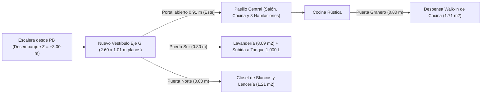

# Plan de Modificación: Conexión Fluida de Escalera y Lavandería + Despensa Walk-In y Clóset de Blancos (Opción A)

**Modelo Objetivo:** [`casa_nuevo_proyecto.dxf`](file:///c:/Users/alvar/Documents/casa/02_Modelos_CAD/casa_nuevo_proyecto.dxf) mediante [`build_nuevo_proyecto.py`](file:///c:/Users/alvar/Documents/casa/04_Scripts_Parametricos/build_nuevo_proyecto.py)  
**Restricciones Intactas:** [`casa_modificaciones.dxf`](file:///c:/Users/alvar/Documents/casa/02_Modelos_CAD/casa_modificaciones.dxf) sin tocar · Escaleras y columnas existentes intactas · Cero invasión al vecino izquierdo (`X >= 0,15 m`) · Buhardilla y Tanque de `1.000 L` preservados.

---

## 🎯 1. Resumen de las Mejoras Arquitectónicas

1. **Nuevo Vestíbulo / Descanso de Llegada alineado al Eje `G` (`Y = 3,60..4,61 m`):**
   - El muro norte de la Lavandería se retranquea `85 cm` hacia el sur para asentarse directamente sobre el **Eje Estructural `G` (`Y = 3,45..3,60 m`)**, alineado con las columnas existentes `0-G` `(0,275, 3,575)` y `1-G` `(2,825, 3,575)` y con el tabique del Mirador Sur.
   - Al terminar de subir la escalera (`Z = +3,00 m`), se dispone ahora de un **vestíbulo plano de `2,60 m` de ancho × `1,01 m` de fondo** (`X = 0,30..2,90 m`), eliminando el encierro anterior.
2. **Portal Abierto de `0,91 m` sin Desniveles hacia toda la Vivienda (`X = 2,75..2,90 m`, `Y = 3,70..4,61 m`):**
   - Se suprime el muro ciego este entre la columna `1-G` (`Y = 3,70 m`) y `Y = 4,40 m` (dejando una viga dintel superior en `Z = +5,25..5,50 m` para soportar la esquina de la losa del tanque con `2,25 m` de paso libre).
   - La baranda rústica de la escalera (`X = 2,75 m`) arranca exactamente en `Y = 4,61 m` con un poste maestro (*newel post*), protegiendo el 100% de los escalones en bajada y dejando **`0,91 m` totalmente planos a cota `Z = +3,00 m`** hacia el Pasillo Central (`3,10 m` de ancho), Gran Salón, Cocina, Habitaciones y Mirador Sur.
3. **Opción A en el Vacío Izquierdo (`X = 0,30..1,55 m`, `Y = 4,40..7,35 m`):**
   - Se funde el paño de losa de entrepiso en `Z = +2,85..3,00 m` (luz corta de `1,10 m` apoyada sobre la medianera propia y el muro divisorio existente de Planta Baja `X = 1,40..1,55 m`), dejando **`2,85 m` a `5,40 m` de altura libre** sobre la escalera al Sótano.
   - Sobre este nuevo piso se levanta el tabique plomado `X = 1,40..1,55 m` (sin restar ni un milímetro al ancho de `1,10 m` de la escalera) y un tabique transversal en `Y = 5,65..5,80 m` que conforma dos espacios de alto valor práctico:
     - **Despensa Rústica Walk-In de Cocina (`1,10 × 1,55 m` libres):** Acceso directo desde la Cocina por puerta corredera tipo granero (`X = 0,50..1,30 m` en `Y = 7,35..7,50 m`, ajustando el retorno del mesón sur para dejar un anteespacio libre de `1,25 × 0,85 m`), equipada con 4 niveles de repisas de madera en L.
     - **Clóset de Blancos / Lencería y Limpieza (`1,10 × 1,10 m` libres):** Acceso mediante puerta doble desde el nuevo Vestíbulo de llegada (`Y = 4,40..4,55 m`, `X = 0,45..1,25 m`), de modo que se puede abrir cómodamente sin estorbar el flujo de la escalera.

> [!IMPORTANT]
> **Coordinación con la Lavandería y el Tanque de `1.000 L`:** La Lavandería queda con unos amplios **`2,45 × 3,30 m` (`8,09 m²`)** conectada directamente al nuevo Vestíbulo por su puerta en `Y = 3,45..3,60 m` (`X = 1,65..2,45 m`). Su escalera fija (`68°`) y escotilla (`0,80 × 1,25 m` en `X = 0,38..1,18 m`, `Y = 2,05..3,30 m`) se invierten para **subir de Sur a Norte**, desembarcando arriba (`Z = +5,68 m`) sobre una plataforma libre y segura de **`0,95 × 2,45 m`** (`Y = 3,30..4,25 m`, justo encima del nuevo descanso), manteniendo intactos el tanque, el equipo hidroneumático y la buhardilla exterior.

---

## 📐 2. Esquema en Planta del Sector Intervenido (`Z = +3,00 m`)

```
                         COCINA RÚSTICA CON ISLA
         Mesón Oeste (Y=8,35..13,20)    Isla Central (X=1,95..2,95)
  Vecino    ║                         ┌──────────────┐
  Izq.      ║   Paso libre 1,25x0,85m │ Mesón Café   │
  (X<0,15)  ╠════╤═════════╤══════════╪══════════════╡ (Y = 7,35..7,50)
     ║      ║    │ Puerta  │          │              │
     ║      ║ ┌──┴─────────┴──┐  Muro │  ESCALERA    │ Baranda Alpina
     ║      ║ │   DESPENSA    │ X=1,40│  SUBE DE PB  │ (X=2,75, protege
     ║      ║ │   WALK-IN     │ ..1,55│ (X=1,55..    │  Y=4,61..7,35)    PASILLO
     ║      ║ │ (1,10x1,55 m) │   ║   │   2,65 m)    │       │           CENTRAL
     ║      ║ │ Repisas en L  │   ║   │      │       │  Col. │           HACIA
     ║      ║ ├───────────────┤   ║   │      ▼       │  1-F  │           SALÓN,
     ║      ║ │   CLÓSET DE   │   ║   │  Peldaño     │       │           COCINA Y
     ║      ║ │    BLANCOS    │   ║   │  Final +3,00 │       ▼           HABITACIONES
     ║      ║ │ (1,10x1,10 m) │   ║   ├───(Y=4,61)───┼──Poste Maestro    (Ancho 3,10m)
     ║      ╠═╧══╤═════════╤══╧═══╩═══╡              │
     ║      ║    │ Puerta  │                         │  ◄── PORTAL PLANO ABIERTO
     ║      ║                 NUEVO VESTÍBULO /      │      DE 0,91 m (Y=3,70..4,61)
     ║      ║                DESCANSO DE LLEGADA     │      SIN ESCALONES (Z=+3,00m)
     ║      ║               (2,60 x 1,01 m planos)   │
     ║      ╠══════════════════╤═════════╤═══════════╬══Col. 1-G═══════ (EJE G: Y=3,45..3,60)
     ║      ║  ┌───────────┐   │ Puerta  │           ║
     ║      ║  │ Subida 68°│   │ 0,80 m  │           ║   ESTAR / MIRADOR
     ║      ║  │ al Tanque │                         ║   POSTERIOR SUR
     ║      ║  │ (Y=2,05.. │   LAVANDERÍA RÚSTICA    ║
     ║      ║  │   3,30 m) │   (2,45 x 3,30 m =      ║
     ║      ║  └───────────┘       8,09 m²)          ║
     ║      ╚════════════════════════════════════════╩═════════════════ (SUR: Y=0,00..0,15)
```

### Flujo de Circulación Integrado en P2



---

## 🔧 3. Cuadro de Dimensiones y Verificaciones Técnicas

| Espacio / Elemento | Cotas en Planta (`X`, `Y_casa`) | Cotas Verticales (`Z`) | Verificación Normativa y Estructural |
| :--- | :--- | :--- | :--- |
| **Nueva Losa Izquierda Escalera** | `X = 0,15..1,55 m`, `Y = 4,40..7,35 m` | `Z = +2,85..3,00 m` | Apoyada en muro P1 existente (`X = 1,40..1,55 m`); deja `2,85 a 5,40 m` libres sobre escalera de Sótano |
| **Despensa Walk-In (Alacena)** | `X = 0,30..1,40 m`, `Y = 5,80..7,35 m` (`1,71 m²`) | `Z = +3,00..5,85 m` | Puerta corredera `0,80 m` hacia Cocina + 4 niveles de estantes en L (`e = 4 cm`) |
| **Clóset de Blancos / Lencería** | `X = 0,30..1,40 m`, `Y = 4,55..5,65 m` (`1,21 m²`) | `Z = +3,00..5,85 m` | Puerta doble `0,80 m` hacia el Vestíbulo sin invadir el paso de la escalera + 4 repisas profundas |
| **Vestíbulo / Descanso Eje `G`** | `X = 0,30..2,90 m`, `Y = 3,60..4,61 m` | `Z = +3,00..5,50 m` | Fondo plano `1,01 m` frente a la escalera (`>= 0,90 m` normativo) |
| **Portal de Conexión al Pasillo** | `X = 2,75..2,90 m`, `Y = 3,70..4,61 m` | `Z = +3,00..5,25 m` | **`0,91 m` de ancho × `2,25 m` de alto libres** a piso corrido `Z = +3,00 m` con viga dintel superior |
| **Lavandería Reconfigurada** | `X = 0,30..2,75 m`, `Y = 0,15..3,45 m` (`8,09 m²`) | `Z = +3,00..5,50 m` | Muro norte alineado en Eje `G`; escalera `68°` invertida Sur→Norte desembarcando en `0,95 × 2,45 m` libres arriba |

> [!TIP]
> **Doble ganancia ergonómica arriba en la Buhardilla (`Z = +5,68 m`):** Al subir ahora la escalera del tanque de Sur a Norte (`Y = 2,10` → `3,25 m`), quien sube pisa al llegar una plataforma despejada de casi `1,00 m` de fondo (`Y = 3,30..4,25 m`) bajo la parte más alta de la buhardilla, lejos del pedestal del tanque (`Y = 0,50..1,80 m`).

---

## 📋 4. Estado de Ejecución en Código y CAD — **100% COMPLETADO ✅**

Se ejecutaron y verificaron todos los cambios en [`build_nuevo_proyecto.py`](file:///c:/Users/alvar/Documents/casa/04_Scripts_Parametricos/build_nuevo_proyecto.py) y [`casa_nuevo_proyecto.dxf`](file:///c:/Users/alvar/Documents/casa/02_Modelos_CAD/casa_nuevo_proyecto.dxf):

1. ✅ **Cierre de Losa y Tabiquería Opción A (`P2_LOSA_PISO_3D`, `P2_MUROS_MADERA_INT_3D`, `P2_TIMBER_FRAME_3D`):** Paño de losa extendido en `Z = +2,85..3,00 m` (`X = 0,15..1,55 m`, `Y = 4,40..7,35 m`), tabiques plomados de Despensa Walk-In y Clóset de Blancos, puerta corredera rústica tipo granero con riel hacia la Cocina, puerta doble hacia el Vestíbulo, 8 niveles de repisas de madera maciza y ajuste del mesón de cocina.
2. ✅ **Descanso en Eje `G` y Portal Fluido (`0,91 × 2,25 m`):** Muro norte de Lavandería alineado en `Y = 3,45..3,60 m`, portal abierto y 100% plano a `Z = +3,00 m` con viga dintel y revestimiento *Timber Frame* en columna `1-G`, y baranda de escalera acotada a `Y = 4,61..7,35 m` con su poste maestro.
3. ✅ **Ajuste de Escotilla y Escalera al Tanque (`P2_LOSA_TANQUE_3D`, `P2_ESCALERA_MANTENIMIENTO_3D`):** Escotilla reubicada en `X = 0,38..1,18 m`, `Y = 2,05..3,30 m` con subida Sur→Norte desembarcando en la plataforma norte (`2,45 × 0,95 m`) y baranda guarda-escotilla en lados Sur y Este.
4. ✅ **Actualización de Rótulos, Láminas 2D y Verificación Geométrica:** Actualizadas `PLANTA_SEGUNDO_PISO_2D` y `PLANTA_TANQUE_1000L_2D`, verificando `0` colisiones en el portal, vestíbulo, escotilla, caja de escalera y linderos.
