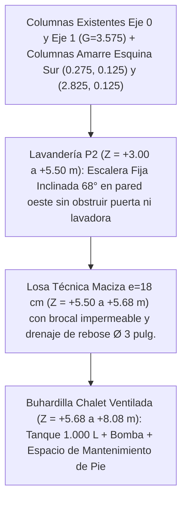

# Plan de Modificación: Buhardilla Técnica Chalet para Tanque de Agua de `1.000 L`
**Ubicación:** Esquina Posterior Izquierda — Encima de la Lavandería (`X = 0,15..2,90 m`, `Y_casa = 0,00..4,40 m`)  
**Modelo Objetivo:** [`casa_nuevo_proyecto.dxf`](file:///c:/Users/alvar/Documents/casa/02_Modelos_CAD/casa_nuevo_proyecto.dxf) *(manteniendo `casa_modificaciones.dxf` intacto)*

---

## 🎯 1. Diagnóstico y Solución Arquitectónica

En el estado actual de [`casa_nuevo_proyecto.dxf`](file:///c:/Users/alvar/Documents/casa/02_Modelos_CAD/casa_nuevo_proyecto.dxf), el faldón izquierdo de la cubierta alpina (`32°`) desciende sobre la Lavandería hasta `Z = +5,95 m`, dejando apenas `0,10 a 0,80 m` sobre el tope de muros (`Z = +5,85 m`), lo que impide alojar un tanque de `1.000 L` (`Ø 1,10 × 1,30 m`) o subir de pie a realizar mantenimiento.

Para resolverlo integrando funcionalidad hidráulica, seguridad de mantenimiento y lenguaje **Chalet Rústico**:

1. **Ajuste de Altura en Lavandería + Nueva Losa Técnica Portante (`Z = +5,50 a +5,68 m`):** La Lavandería queda con una altura libre confortable y normativa de **`2,50 m`** (`Z = +3,00 a +5,50 m`), coronada por una losa maciza de concreto armado (`e = 18 cm`) impermeabilizada con brocal anti-derrames.
2. **Buhardilla / Lucarna Alpina Ventilada (*Shed Dormer Chalet*):** Solo en el cuadrante posterior izquierdo (`X = 0,15..3,85 m`, `Y_casa = 0,00..4,40 m`), nace del faldón oeste una buhardilla rústica de madera por debajo de la cumbrera (`Z = +8,08 m` a `+7,56 m`), generando un **cuarto técnico cubierto con altura libre interior de `1,88 m` a `2,23 m`** para trabajar cómodamente de pie y a la sombra.
3. **Respeto Estricto al Vecino Izquierdo (`X = 0,15 m`):** En ese tramo posterior, el muro ciego propio izquierdo (`X = 0,15..0,30 m`) sube como parapeto cortafuegos hasta `Z = +7,85 m` con **alero cero (`0,00 m`)** y canalón pluvial oculto interno (`X = 0,30..0,55 m`), sin invadir ni verter aguas hacia `X < 0,15 m`.

> [!IMPORTANT]
> **Presión por Gravedad Garantizada:** Al quedar la base del tanque a `Z = +5,80 m` (`+2,80 m` por encima del piso del Último Piso `Z = +3,00 m`), toda la vivienda (duchas de Master Suite, Baño Familiar, Cocina, Local Comercial y Sótano) contará con suministro por gravedad incluso ante cortes eléctricos, además del equipo presurizador.

---

## 📐 2. Distribución en Planta y Corte del Nuevo Espacio Superior (`Z = +5,68 m`)

El recinto técnico encima de la Lavandería dispone de **`2,45 × 4,10 m` libres (`10,05 m²`)**, organizando con holgura el acceso, el tanque, el equipo de bombeo y los pasillos de inspección:

```
                  CORTE CON FALDÓN PRINCIPAL (NORTE — Y = 4,40 m)
  Vecino    ┌───────────────────────────────────────────────────┐
  Izquierdo │  ┌──────────────────┐   ÁREA DE DESEMBARQUE       │
  (X<0,15)  │  │ ESCOTILLA ACCESO │   Y TABLERO ELÉCTRICO       │
  SIN ALERO │  │   (0,80 x 1,25m) │   (Altura libre ~2,20 m)    │
     ║      │  │  Sube escalera   │                             │
     ║ Muro │  │  fija 68° c/pasa-├─────────────────────────────┤
     ║ Ciego│  │  manos de segur. │ BANCADA HIDRONEUMÁTICA      │ Muro Este
     ║ Pro- │  └──────────────────┘ Bomba + Pulmón + Filtro     │ Buhardilla
     ║ pio  │     Baranda guarda-   + By-pass gravedad          │ en Madera
     ║ +    │     escotilla 1,00m   (0,85 x 1,10 m)             │ (X=2,75..2,90)
     ║ Cana-│                                                   │
     ║ lón  │          ┌───────────────────────┐                │
     ║ Ocul-│  Pasillo │   PEDESTAL CONCRETO   │  Pasillo       │
     ║ to   │  Oeste   │    (1,30 x 1,30 m)    │  Mantenimiento │
     ║      │  0,62 m  │   TANQUE AGUA 1.000 L │  Este 0,65 m   │
     ║      │          │  (Ø 1,10 m x H 1,30m) │                │
     ║      │          └───────────────────────┘                │
     ║      │       Pasillo Sur Inspección libre (0,50 m)       │
     ║      └──────────═══════╤═══════════════╤═════════════════┘
                        PANEL DOBLE DE CELOSÍA RÚSTICA ABATIBLE (1,45 x 1,45 m)
                        (Ventilación cruzada + Izaje directo del tanque desde el patio)
```

### Flujo Técnico y Estructural por Nivel



---

## 🔧 3. Especificaciones Técnicas de Diseño, Acceso y Mantenimiento

| Componente | Solución Propuesta | Dimensiones y Cotas |
| :--- | :--- | :--- |
| **Capacidad y Tanque** | Tanque cilíndrico vertical tricapa `1.000 L` con tapa roscada superior y flotante | `Ø 1,10 m × H = 1,30 m` (tope en `Z = +7,10 m`, dejando `+0,65 m` libres arriba para abrir tapa y lavar) |
| **Soporte Estructural** | Losa de concreto armado `e = 18 cm` sobre 4 muros portantes + 2 columnas posteriores de amarre `(0,275, 0,125)` y `(2,825, 0,125)` desde PB a P2 | Carga viva/hidrostática `~1.350 kg` distribuida en luz corta de `2,45 m` |
| **Escalera de Subida** | Escalera fija inclinada (`68°`) en acero/madera adosada al muro oeste (`X = 0,35..1,05 m`), con doble pasamanos prolongado `+1,00 m` sobre el nivel superior | Huellas antideslizantes de `18 cm`; no estorba la puerta de lavandería (`X = 1,65..2,45 m`) ni las máquinas |
| **Seguridad Arriba** | Escotilla de `0,80 × 1,25 m` protegida con **baranda guarda-cuerpo de `1,00 m`** en piso técnico para evitar caídas accidentales durante el mantenimiento | Área libre de trabajo de pie de `~6,5 m²` alrededor de tanque y bomba |
| **Izaje y Ventilación** | **Puerta doble de celosías rústicas de madera (`1,45 × 1,45 m`)** en la fachada sur de la buhardilla (`Y_casa = 0,00 m`) | Oculta el tanque, ventila el cuarto técnico y permite meter o reemplazar el tanque desde el patio trasero |
| **Cubierta Buhardilla** | Faldón rústico a un agua (`8,5°`) desde `X = 3,85 m` (`Z = +8,08 m`) hacia canalón oculto propio en `X = 0,30..0,55 m` (`Z = +7,56 m`), más alero sur de `1,00 m` | `0,00 m` de vuelo hacia el vecino izquierdo (`X >= 0,15 m` estricto) |

> [!TIP]
> **Aprovechamiento bajo la escalera en Lavandería:** El triángulo inferior bajo la escalera inclinada (`X = 0,35..1,05 m`, `Y_casa = 2,75..3,85 m`) sirve como gabinete escobero y almacén de detergentes, dejando todo el frente sur y este de la Lavandería libre para lavadora, secadora y batea con iluminación natural.

---

## 📋 4. Estado de Ejecución en `casa_nuevo_proyecto.dxf` — **100% COMPLETADO ✅**

Se actualizaron [`build_nuevo_proyecto.py`](file:///c:/Users/alvar/Documents/casa/04_Scripts_Parametricos/build_nuevo_proyecto.py) y [`casa_nuevo_proyecto.dxf`](file:///c:/Users/alvar/Documents/casa/02_Modelos_CAD/casa_nuevo_proyecto.dxf) incorporando y verificando las nuevas capas CAD 3D y 2D:

1. ✅ **Refuerzo y Losa Técnica (`P2_LOSA_TANQUE_3D`):** Losa portante en `Z = +5,50..5,68 m` sobre las 4 columnas de esquina (incluyendo amarres posteriores `(0,275, 0,125)` y `(2,825, 0,125)`), con escotilla libre de columnas (`0,80 × 1,25 m` en `X = 0,42..1,22 m`), pedestal de concreto (`1,30 × 1,30 × 0,12 m`) y bancada hidroneumática.
2. ✅ **Acceso y Seguridad (`P2_ESCALERA_MANTENIMIENTO_3D`):** Escalera fija inclinada (`68°`, `9` peldaños antideslizantes de `60 × 18 cm`) en Lavandería con pasamanos dobles prolongados `+1,00 m` y baranda guarda-escotilla perimetral de `1,00 m`.
3. ✅ **Equipamiento Hidráulico 3D (`EQUIPO_HIDRONEUMATICO_3D`):** Tanque cilíndrico de `1.000 L` (`Ø 1,10 × 1,30 m` + tapa roscada superior `Ø 0,44 m` en `Z = +7,18 m`), bomba presurizadora, pulmón hidroneumático, filtro y tubería by-pass por gravedad.
4. ✅ **Envolvente Buhardilla Chalet (`BUHARDILLA_TECNICA_3D` y `PLANTA_TANQUE_1000L_2D`):** Muros de madera rústica, parapeto cortafuegos propio elevado a `Z = +7,85 m` con canalón oculto interno (`0` invasiones a `X < 0,15 m`), cubierta a `8,5°` acoplada sin escalones al faldón principal (`32°`), panel doble de celosías rústicas abatibles (`1,45 × 1,45 m`) en fachada sur y lámina de planta técnica 2D dedicada.
