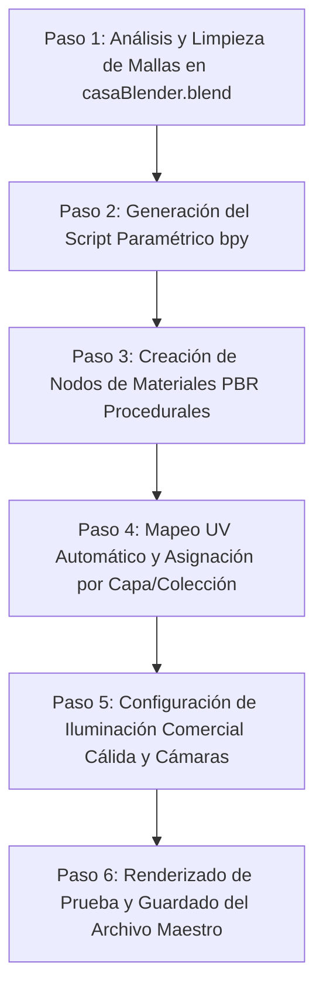

# Plan de Texturizado y Materiales Fotorrealistas en Blender para la Zona Comercial

## 1. Objetivo y Alcance
Dotar al modelo 3D en **Blender** (`02_Modelos_CAD/casaBlender.blend`) de una ambientación fotorrealista coherente con el estilo **Chalet Rústico Alpino**, aplicando materiales PBR (Physically Based Rendering), mapeo UV coordinado, iluminación cálida de exhibición comercial y vistas de cámara listas para renderizado con **Cycles** o **Eevee**.

El alcance se concentra en toda la **Planta Baja (`N.P.T. ±0,00 m`)**:
1. **Salón de Frutería y Verdulería (`88,85 m²`)**
2. **Gran Almacén Unificado con Cuarto Frío (`33,09 m²`)**
3. **Estacionamiento Fluido y Portón Curvo Lateral (`46,20 m²`)**
4. **Fachada Comercial Frontal sobre Avenida 4**

---

## 2. Catálogo de Materiales y Texturas PBR

| Zona / Elemento | Material Propuesto | Configuración Shader (Principled BSDF) | Textura / Mapa |
| :--- | :--- | :--- | :--- |
| **Piso Salón Frutería** | Microcemento alisado / Baldosas rústicas de barro cocido claro | Base Color: `#E0D5C1`, Roughness: `0.45`, Normal/Bump: relieve sutil de juntas | Procedural Voronoi + Noise con Bump |
| **Muros y Pilastras** | Estuco rústico blanco cálido + Zócalo de Piedra Laja Alpina | Base Color: `#F4F1EA`, Roughness: `0.85`; Zócalos: `#8D7B68` con relieve de piedras | Mapeo procedural de piedra laja con desplazamiento |
| **Islas Piramidales (4)** | Roble macizo natural encerado (cajones y niveles de fruta) | Base Color: `#A67C52`, Roughness: `0.35`, Specular: `0.5`, Veteado marcado | Procedural Wave + Noise para madera de roble |
| **Estanterías Murales** | Estructura de roble rústico y bandejas verde bosque suave | Frutas: Roble `#8C6239`; Verduras: Verde `#2E4A35`, Roughness: `0.50` | Vetas de madera satinada |
| **Mostrador Caja / Pesaje** | Murete de piedra laja rústica + Tope de madera maciza barnizada | Base piedra: `#5A4D41` (Rough: `0.9`); Encimera: `#6B4226` (Rough: `0.25`, Clearcoat: `0.3`) | Combinación piedra laja + madera de nogal barnizada |
| **Equipos de Caja** | Balanzas digitales y Pantalla TPV | Balanzas: Inox cepillado (`Metallic: 1.0`, `Rough: 0.25`); TPV: Plástico negro mate (`#1A1A1A`) | Acero inoxidable satinado + pantallas emisivas |
| **Piso Gran Almacén** | Concreto pulido con recubrimiento epóxico gris claro | Base Color: `#B0B5B3`, Roughness: `0.20`, Specular: `0.6` (alto tránsito limpio) | Concreto epóxico con reflejos sutiles |
| **Cámara Frigorífica** | Paneles isotérmicos modulares de poliuretano blanco satinado | Base Color: `#F0F3F4`, Roughness: `0.30`, Perfilería aluminio anodizado (`Metallic: 0.9`) | Paneles sándwich ranurados blancos |
| **Mesón y Lavaderos** | Acero Inoxidable industrial AISI 304 | Base Color: `#D8D8D8`, Metallic: `1.0`, Roughness: `0.22`, Anisotropy: `0.4` | Inox cepillado direccional |
| **Racks Industriales** | Estructura de acero esmaltado negro mate / antracita con bandejas | Base Color: `#262626`, Metallic: `0.75`, Roughness: `0.40` | Metal industrial electrostático |
| **Piso Estacionamiento** | Pavimento de concreto fratasado antideslizante | Base Color: `#9E9E9E`, Roughness: `0.70`, Bump suave antideslizante | Concreto ranurado / fratasado |
| **Portón Corredizo** | Bastidor de hierro forjado negro + Listones de teca rústica | Hierro: `#151515`, Metallic: `0.85`, Rough: `0.4`; Madera: `#70482B`, Rough: `0.45` | Teca impregnada para intemperie |
| **Santamarías Av. 4** | Lamas acanaladas de aluminio anodizado mate | Base Color: `#78909C`, Metallic: `0.90`, Roughness: `0.35` | Acanalado metálico horizontal |
| **Marquesina Frontal** | Vigas y viguetas de madera oscura envejecida | Base Color: `#4A2E1B`, Roughness: `0.60`, Veteado rústico profundo | Madera alpina envejecida |

---

## 3. Plan de Ejecución Paso a Paso

### Paso 1: Inspección y Organización de Objetos en Blender
* Analizar la estructura interna de colecciones y mallas en `02_Modelos_CAD/casaBlender.blend`.
* Organizar los objetos de la Planta Baja en colecciones temáticas:
  * `COL_Fruteria_Estructura` (Pisos, Muros, Pilastras, Columnas Eje 2).
  * `COL_Fruteria_Mobiliario` (4 Islas piramidales, estantes murales, mostrador caja).
  * `COL_Almacen_Equipamiento` (Piso epoxi, cuarto frío, mesón inox, racks).
  * `COL_Estacionamiento` (Piso garaje, portón curvo corredizo, riel, acceso escaleras).
  * `COL_Fachada_Avenida4` (Santamarías de caracol, marquesina, marcos de acceso).

### Paso 2: Desarrollo del Script de Automatización (`bpy`)
* Crear el script de Python [`04_Scripts_Parametricos/texturizar_zona_comercial_blender.py`](file:///c:/Users/alvar/Documents/casa/04_Scripts_Parametricos/texturizar_zona_comercial_blender.py).
* Diseñar funciones para:
  1. `create_pbr_material(name, base_color, roughness, metallic, bump_type)`: construye redes de nodos en el Shader Editor de Blender sin dependencias externas (procedural 100% autónomo).
  2. `apply_smart_uv_projection(obj)`: desenvuelve las mallas para eliminar estiramientos en aristas.
  3. `assign_materials_by_name()`: vincula automáticamente cada material con las piezas del modelo exportado.

### Paso 3: Iluminación Arquitectónica y Comercial
* **Luz de Entorno (World / HDRI):** Luz diurna natural suave (temperatura ~5500K) que penetra por la fachada de Avenida 4 y ventanas este/sur.
* **Iluminación Comercial Focal (Interior Frutería):**
  * Luminarias cálidas suspendidas (3000K - 3200K, CRI alto) sobre cada una de las 4 islas piramidales para resaltar los colores naturales de las frutas.
  * Tira LED cálida continua oculta bajo las repisas de madera de los estantes murales.
  * Iluminación funcional neutra (4000K) para la caja registradora, balanzas y el gran almacén.

### Paso 4: Posicionamiento de Cámaras Cinematográficas
* **Cámara 1 (Perspectiva Entrada Av. 4):** Vista a nivel de peatón desde la calle mirando hacia la frutería con las santamarías abiertas, mostrando el acceso fluido y las islas de frutas.
* **Cámara 2 (Interior Frutería):** Vista angular amplia desde la caja hacia el salón comercial, apreciando el recorrido de clientes, las estanterías de roble y las 4 columnas vestidas.
* **Cámara 3 (Gran Almacén y Cuarto Frío):** Vista interna del almacén de 8,70 m de ancho, mostrando el cuarto frío, el mesón de lavado y los racks de carga.
* **Cámara 4 (Estacionamiento):** Vista longitudinal mostrando el portón corredizo articulado plegado en el lateral y el acceso despejado a las escaleras.

### Paso 5: Verificación y Entrega
* Ejecutar el script y generar el archivo guardado: `02_Modelos_CAD/casaBlender_texturizada.blend`.
* Generar renders de muestra en formato PNG a alta resolución para comprobar reflejos, rugosidades y proporciones de texturas.

---

## 4. Métodos de Ejecución para el Usuario

Una vez creado el script, podrás aplicarlo de dos formas sencillas:
1. **Directamente en la interfaz de Blender:**
   * Abrir `casaBlender.blend`.
   * Ir al espacio de trabajo **Scripting** (pestaña superior).
   * Abrir o pegar `texturizar_zona_comercial_blender.py`.
   * Pulsar **Run Script** (o `Alt + P`).
2. **Desde la línea de comandos / terminal:**
   * Ejecutar Blender en modo script automático para texturizar y renderizar automáticamente sin abrir la ventana gráfica.
