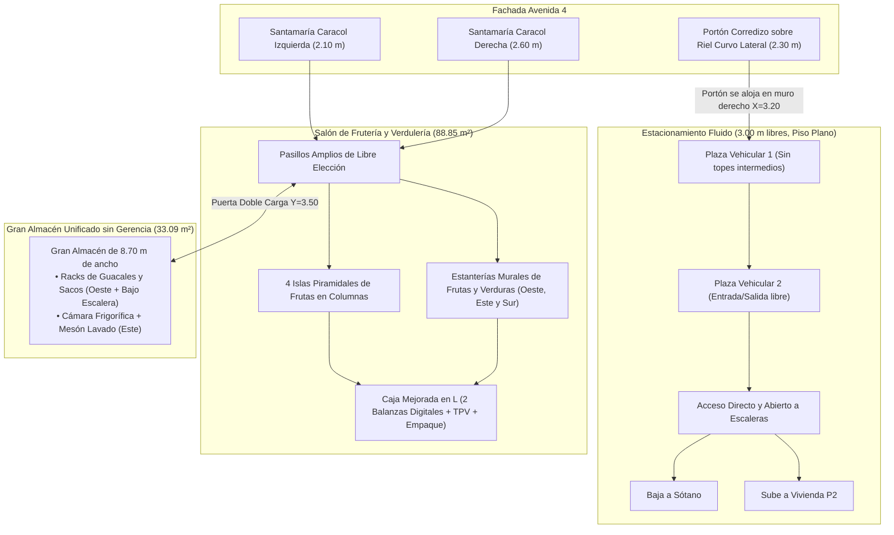

# Plan de Rediseño: Frutería y Verdulería Estilo Chalet Rústico Alpino + Estacionamiento Despejado (EJECUTADO Y VERIFICADO)

**Estado:** ✅ **Completado y Verificado en CAD**  
**Modelo CAD Destino:** [`02_Modelos_CAD/casa_nuevo_proyecto.dxf`](file:///c:/Users/alvar/Documents/casa/02_Modelos_CAD/casa_nuevo_proyecto.dxf)  
**Generador Paramétrico:** [`04_Scripts_Parametricos/build_nuevo_proyecto.py`](file:///c:/Users/alvar/Documents/casa/04_Scripts_Parametricos/build_nuevo_proyecto.py#L485-L750)  
**Estadísticas del Modelo:** `1.121` sólidos 3D · `1.076` líneas 2D · `124` textos · `47` capas declaradas (`0` huérfanas)  
**Nivel de Intervención:** Planta Baja (`Z = 0,00 m` a `+2,85 m`, huella `9,00 × 21,71 m = 195,39 m²`)  

---

## 🍎 1. Concepto Arquitectónico: Mercado Orgánico / Frutería Alpina

El espacio comercial se transforma en una **Frutería y Verdulería de Categoría (*Mercado Fresco Estilo Chalet Alpino*)**, donde la arquitectura de **piedra laja rústica, vigas y postes de madera maciza (*Timber Frame*) y herrajes de hierro forjado negro** realza el color natural de las frutas y verduras:

* **Cero Mesas de Restaurante o Cafetería:** Se eliminan todas las mesas centrales tipo *comedor/showroom*, las poltronas lounge y la estación de café, liberando el piso para una experiencia de compra ágil, limpia y espaciosa.
* **Circulación Fluida en Circuito (`Pasillos Libres de 1,25 m a 1,65 m`):** El cliente ingresa desde la Avenida 4 y puede recorrer libremente el local rodeando las islas centrales de las columnas o caminando junto a los estantes murales sin cuellos de botella.
* **Integración Estructural Inteligente:** Las 4 columnas centrales del Eje 2 (`X = 5,925 m`) se revisten en madera maciza y se rodean con **Islas Piramidales de Frutas a 4 Caras**, convirtiendo la estructura en el corazón de la exhibición.

---

## 🛠️ 2. Las 6 Mejoras Clave del Plan

### 2.1 Entrada Comercial con Santamarías de Caracol (Enrollables hacia Arriba)
* **Eliminación de las Vitrinas Cerradas y Puerta Confusa:** Se retiran los cristales fijos y marcos pequeños que no permitían distinguir la entrada.
* **Doble Portal Comercial Abierto de Piso a Dintel (`X = 3,65..5,75 m` y `X = 6,20..8,80 m`, `H = 2,40 m`):**
  * Al abrir el negocio, todo el frente comercial queda **100% abierto y permeable** hacia la Avenida 4, dividido únicamente por el pilar de piedra rústica de la columna central (`X = 5,75..6,20 m`).
* **Sistema de Santamaría Tipo Caracol Superior (`Z = 2,05..2,42 m`):**
  * En el dintel superior de cada portal se modela el **Tambor / Caracol Cilíndrico de Enrollado** en acero negro mate (`Ø 38 cm`), donde la cortina metálica se recoge girando hacia arriba.
  * Incluye **carriles guía laterales en U** adosados a las pilastras de piedra y la **faldilla inferior de láminas microperforadas con manillas de agarre** asomando a `Z = 2,05 m`, dejando claro visualmente en 2D y 3D que es una santamaría enrollable vertical.
  * Exteriormente se conserva la **Marquesina Rústica de Madera y Teja Pizarra** (`Z = 2,42..2,70 m`) que protege del sol y la lluvia tanto a las santamarías como a los clientes.

---

### 2.2 Islas de Frutas en las Columnas Centrales (Eje 2: `X = 5,925 m`)
En lugar de mesas sueltas, cada una de las **4 columnas interiores** (`Y = 18,575 m`, `Y = 16,325 m`, `Y = 12,025 m` y `Y = 8,875 m`) incorpora una **Isla Exhibidora de Frutas de 4 Caras (`1,50 × 1,50 m`)** que abraza la columna:
* **Basamento Protector de Piedra Rústica (`Z = 0,00..0,35 m`):** Protege el mueble del roce de pies y carritos de compra.
* **Bandejas Escalonadas en Madera de Roble (`Z = 0,35..0,78 m` y `Z = 0,78..1,15 m`):** Dos niveles perimetrales inclinados con divisiones para guacales de frutas de alta rotación (manzanas, naranjas, mandarinas, mangos, aguacates, piñas, cambures), permitiendo al cliente escoger cómodamente por los 4 lados.
* **Columna Central en Madera Maciza (*Timber Frame*):** Sube desde el centro de la isla hasta las vigas del techo, incorporando a `Z = 1,75 m` pizarras rústicas de precios en las 4 caras y luminarias cálidas dirigidas hacia la fruta.

---

### 2.3 Estanterías para Frutas y Verduras en Todas las Paredes
Todo el perímetro del salón comercial se equipa con estanterías rústicas de madera de roble y estructura de hierro negro:

1. **Muro Oeste Completo (Lado Izquierdo del Salón, `X = 3,45..4,15 m` en `Y = 9,00..20,80 m` y `X = 2,90..3,60 m` en `Y = 4,00..8,80 m`):**
   * **Módulos de Frutería de 4 Niveles Inclinados (`H = 2,15 m`, prof. `0,65 m`):**
     * **Nivel Inferior (`Z = 0,15..0,50 m`):** Cestas profundas de madera para frutas grandes y pesadas (patillas, melones, auyamas, cocos).
     * **Niveles Centrales (`Z = 0,65 m`, `1,10 m` y `1,55 m`):** Repisas inclinadas a `15°` con topes frontales de madera para guacales de frutas seleccionadas.
     * **Coronamiento Rústico (`Z = 1,95..2,15 m`):** Cenefa de madera labrada con espejo superior inclinado (efecto clásico de frutería que multiplica la vista del producto) e iluminación integrada.
2. **Muro Este (Lado Derecho bajo Ventanales, `X = 8,30..8,98 m`, `Y = 5,65..16,50 m`):**
   * **Estanterías Frescas de Verduras y Hortalizas (`H = 0,95 m` bajo ventanas y `H = 2,10 m` entre paños):**
     * Diseñadas a altura ergonómica bajo los ventanales Este para **no bloquear la luz natural ni la ventilación**, ideales para verduras de hoja, tomates, pimentones, brócoli, zanahorias y hierbas aromáticas.
3. **Muro Sur del Salón (`Y = 5,55..6,15 m`, `X = 6,00..8,85 m`, frente al baño):**
   * **Estantería Rústica de Tubérculos y Granel (`H = 1,80 m`):** Cajoneras ventiladas de madera para papas, cebollas, ajos, yuca y plátanos.

---

### 2.4 Diseño Mejorado de la Caja y Zona de Pesaje (Misma Ubicación Frontal Este)
Se mantiene en su ubicación ideal junto a la entrada (`X = 6,80..8,75 m`, `Y = 17,00..18,80 m`), rediseñada específicamente para el flujo rápido de una frutería:
* **Mostrador en "L" de Piedra Laja y Roble Macizo (`H = 0,95 m`):**
  * Cuerpo frontal revestido en mampostería de piedra rústica con cantoneras de hierro forjado y encimera ancha de roble macizo impermeabilizado.
  * **Frente con Nichos Exhibidores de Impulso:** Repisas frontales empotradas hacia el cliente para miel, frutos secos, especias y bolsas ecológicas.
* **Estación Doble de Pesaje y Cobro:**
  * **2 Balanzas Electrónicas Comerciales con Mástil Visor** sobre el tramo largo para pesar las bolsas de frutas y verduras a la vista del cliente.
  * **Terminal TPV con Pantalla Táctil + Gaveta de Dinero** en el ángulo de la "L".
  * **Zona de Empaque Rápido** con portarrollos de bolsas y mueble bajo trasero de apoyo (`X = 7,30..8,85 m`, `Y = 16,80..17,25 m`).

---

### 2.5 Eliminación de Gerencia y Creación del Gran Almacén / Centro de Acopio (`33,09 m²`)
* **Eliminación de la Oficina de Gerencia:** Se suprime por completo el tabique `X = 6,25..6,40 m` (`Y = 0,15..3,50 m`) y todo el mobiliario de oficina (escritorio, sillón, sillas).
* **Unificación de Pared a Pared (`X = 0,30..9,00 m`, `8,70 m` de ancho continuo):**
  * El almacén abarca ahora **todo el ancho posterior de la edificación** (`8,70 × 3,35 m = 29,15 m²`) más la alcoba integrada bajo la escalera (`3,94 m²`), alcanzando un total de **`33,09 m²`**.
* **Acceso Único y Exclusivo desde la Frutería:**
  * Se mantiene **100% cerrado hacia el estacionamiento y escaleras**.
  * El único acceso es desde el salón de la frutería a través de una **Puerta Doble de Carga (`1,20 m` de ancho, `X = 4,00..5,20 m`, `Y = 3,50..3,65 m`)** que permite el paso holgado de carretillas con sacos y guacales.
* **Zonificación Interna del Gran Almacén para Frutas y Verduras:**
  1. **Zona Oeste y Bajo Escalera (`X = 0,30..3,80 m`):** Estanterías industriales de carga pesada para sacos de tubérculos, cajas de reserva e insumos.
  2. **Zona Central de Maniobra (`X = 3,80..6,20 m`):** Pasillo amplio despejado para recepción, clasificación y pesaje de bultos.
  3. **Zona Este (antigua Gerencia, `X = 6,20..9,00 m`):**
     * **Cuarto Frío / Cámara Frigorífica Modular (`X = 6,40..8,90 m, Y = 0,20..1,75 m`):** Para conservar frutas delicadas y verduras frescas en frío.
     * **Mesón de Lavado, Selección y Preparación en Acero y Madera (`X = 7,80..8,95 m, Y = 1,90..3,40 m`):** Con bacha profunda para lavar hortalizas antes de sacarlas a los estantes.

---

### 2.6 Corrección del Estacionamiento: Sin Topes en Fila y con Acceso Directo a Escaleras
Se corrigen los dos problemas señalados en el garaje (`X = 0,30..3,30 m`, `3,00 m` libres):
1. **Eliminación Total de los Topes en Fila:**
   * Se retiran los topes físicos elevados (`Y = 15,35 m` y `Y = 9,55 m`) y las losetas resaltadas que estorbaban el paso de las ruedas.
   * El piso del estacionamiento queda **100% plano, continuo y libre de obstáculos (`Z = 0,00 m`)**, permitiendo que ambos vehículos entren y salgan con total suavidad. En el plano solo se indican líneas guía de pavimento a ras de suelo.
2. **Apertura Total del Acceso a las Escaleras (Sótano y Segundo Piso):**
   * Se **elimina el muro transversal con puerta estrecha en `Y = 8,80..8,95 m`** y se **elimina el banco de trabajo** que bloqueaba el fondo del garaje.
   * Ahora el estacionamiento se conecta de forma **100% abierta, directa y sin obstáculos** con el arranque de ambas escaleras en `Y = 7,35..7,40 m`:
     * **Carril Izquierdo (`X = 0,30..1,40 m`):** Acceso directo para bajar por la escalera al **Sótano**.
     * **Carril Derecho (`X = 1,55..2,65 m`):** Acceso directo para subir por la escalera al **Segundo Piso (Vivienda)**.
   * El **Almacén Comercial sigue 100% aislado** detrás de las escaleras gracias a los muros ciegos en `Y = 4,25..4,40 m` y bajo la zanca de la escalera en `Y = 5,80..5,95 m`.
3. **Portón Vehicular Corredizo-Articulado sobre Riel Lateral a 90° (`X = 0,40..2,70 m`):**
   * **Aprovechamiento Inteligente del Receso Lateral (`X = 2,95..3,30 m`):** Entre la columna frontal derecha del portón (`X = 2,70..2,95 m`) y el muro divisorio del estacionamiento (`X = 3,30 m`) existe un bolsillo libre de **`35 cm` de fondo**.
   * **Sistema Corredizo Seccional en Curva Lateral (4 Hojas Articuladas de Madera y Forja):**
     * El portón se compone de 4 paneles articulados (`57,5 cm × 2,35 m` cada uno) suspendidos de un **riel superior de hierro forjado con curva a 90°** y guía inferior embutida a ras de suelo.
     * Al abrirse, el portón se dobla siguiendo el riel curvo y **se estaciona completamente plano contra el muro lateral derecho del garaje (`X = 3,16..3,28 m`, `Y = 19,10..21,45 m`)**, quedando **100% escondido detrás de la columna frontal (`X = 2,70..2,95 m`)**.
   * **Ventajas Espaciales:**
     * **100% de ancho de entrada libre (`2,30 m`)** sin hojas que sobresalgan al paso del auto.
     * **100% de altura libre en el techo (`2,65 m`)** sin tambores ni rieles colgantes en medio del garaje (ideal para camionetas altas o SUVs con portaequipajes).

---

## 📐 3. Esquema en Planta de la Nueva Distribución (`Z = 0,00 m`)

```
   AVENIDA 4 (FACHADA PRINCIPAL: Y = 21,71 m)
   +-------------------+-----------------------+-----------------------------+
   | PORTÓN CORREDIZO  |  ENTRADA SANTAMARÍA 1 |  ENTRADA SANTAMARÍA 2       |
   | SOBRE RIEL LATERAL|  (Caracol Enrollable  |  (Caracol Enrollable        |
   | (2,30 m libre)    |   Arriba, 2,10 m)     |   Arriba, 2,60 m)           |
   +===================+=======================+=============================+ Y = 21,56
   |              [Riel| [Estantes]            |                             |
   |            Curvo]║| [Muro    ]  (Pasillo) |   CAJA Y PESAJE MEJORADA    |
   | PLAZA VEHICULAR 1║| [Oeste   ]            |   • Mostrador L Piedra/Roble|
O  | (Portón doblado y║| [Frutas  ]  +-------+ |   • 2 Balanzas Digitales    | E
E  |  alojado en muro ║| [        ]  | ISLA  | |   • TPV + Empaque Rápido    | S
S  |  derecho X=3,20) ║| [        ]  | COL.1 | +-----------------------------+ T
T  |                   | [        ]  +-------+               [Estantes Este] | E
E  |                   | [        ]  (Pasillo Amplio 1,50 m) [Verduras     ] |
   | - - - - - - - - - | [        ]  +-------+               [Frescas bajo ] | Y = 15,00
   |                   | [        ]  | ISLA  |               [Ventanales   ] |
   | PLAZA VEHICULAR 2 | [Estantes]  | COL.2 |               [             ] |
   | (Piso 100% plano  | [Murales ]  +-------+               [             ] |
   |  y libre de       | [Inclin. ]                          [             ] |
   |  obstáculos)      | [de Roble]  +-------+               [             ] |
   |                   | [para    ]  | ISLA  |               [             ] |
   |                   | [Frutas  ]  | COL.3 |               [             ] |
   |                   | [        ]  +-------+               [             ] |
   |                   | [        ]                          [             ] |
   |                   | [        ]  +-------+               [             ] |
   |                   | [        ]  | ISLA  |               [             ] |
   |                   | [        ]  | COL.4 |               [             ] |
   |                   | [        ]  +-------+   [Estantes Tubérculos/Raíces]|
   + - - - - - - - - - + [        ]              +---------------------------+ Y = 5,55
   | ACCESO DIRECTO    | [        ]              | BAÑO COMERCIAL RÚSTICO    |
   | ABIERTO A AMBAS   | [        ]              | (Lavamanos Piedra + WC)   |
   | ESCALERAS:        |                         +---------------------------+ Y = 3,50
   | • Baja a Sótano   +======[PUERTA CARGA]=====+                           |
   | • Sube a P2       |                         |                           |
   +===[MURO CIEGO]====+                         |                           |
   | [Bajo Escalera    |    GRAN ALMACÉN UNIFICADO DE FRUTERÍA (33,09 m²)    |
   |  Estanterías]     |    (Unido con antigua Gerencia: 8,70 m de ancho)    |
   |                   | • Racks Secos (Oeste) • Cuarto Frío + Lavado (Este) |
   +-------------------+-------------------------+---------------------------+ Y = 0,15
                       |<------------- 8,70 m de ancho total --------------->|
```

---

## 🔄 4. Flujo de Clientes, Vehículos y Mercancía



---

## 📋 5. Pasos de Implementación en el Modelo CAD (`build_nuevo_proyecto.py`)

1. **Unificación Total del Almacén (`33,09 m²`):**
   * Eliminar el muro `X = 6,25..6,40 m` (`Y = 0,15..3,50 m`) y retirar el mobiliario de gerencia.
   * Equipar el ala este del almacén con una **Cámara Frigorífica / Cuarto Frío** y **Mesón de Lavado y Selección de Verduras**, manteniendo las baterías de racks en el oeste, sur y bajo escalera.
2. **Modelado de las Santamarías de Caracol (Frutería) y Portón Corredizo Lateral (Garaje):**
   * En los 2 vanos comerciales (`X = 3,65..5,75 m` y `X = 6,20..8,80 m`): modelar los portales abiertos con **tambores cilíndricos superiores (caracol)** en `Z = 2,05..2,42 m` y guías laterales.
   * En el vano del estacionamiento (`X = 0,40..2,70 m`): modelar el **riel superior con curva a 90°** y las **4 hojas articuladas de madera y forja plegadas/deslizadas sobre el muro lateral derecho (`X = 3,16..3,28 m`, `Y = 19,10..21,45 m`)**, dejando el vano vehicular 100% despejado en ancho y altura.
3. **Modelado de Islas de Frutas en Columnas y Estanterías Murales:**
   * Construir las **4 Islas Piramidales de Frutas** abrazando las columnas del Eje 2 (`X = 5,925 m`).
   * Construir los **Estantes Murales Inclinados** para frutas y verduras a lo largo del muro oeste, muro este (bajo ventanas) y muro sur.
4. **Rediseño del Mostrador de Caja y Pesaje:**
   * Mejorar el mostrador en L (`X = 6,80..8,75 m, Y = 17,00..18,80 m`) con 2 balanzas digitales con visor, nichos frontales de impulso, TPV y mesa trasera de empaque.
5. **Despeje del Estacionamiento y Apertura a las Escaleras:**
   * Eliminar los topes de rueda en fila (`Y = 15,35 m` y `Y = 9,55 m`) y el banco de trabajo trasero.
   * Eliminar el tabique y puerta de `Y = 8,80..8,95 m` para dejar **paso libre y directo desde el estacionamiento hacia las dos escaleras**, manteniendo el almacén 100% sellado por detrás.
6. **Actualización de Lámina 2D (`PLANTA_BAJA_2D`), Rótulos y Verificación `verify_dxf.ps1`:**
   * Regenerar [`02_Modelos_CAD/casa_nuevo_proyecto.dxf`](file:///c:/Users/alvar/Documents/casa/02_Modelos_CAD/casa_nuevo_proyecto.dxf) y comprobar `0` colisiones y `100%` de integridad estructural.
