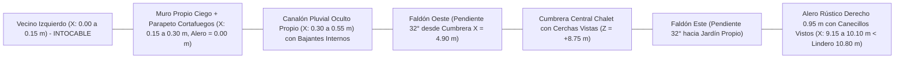
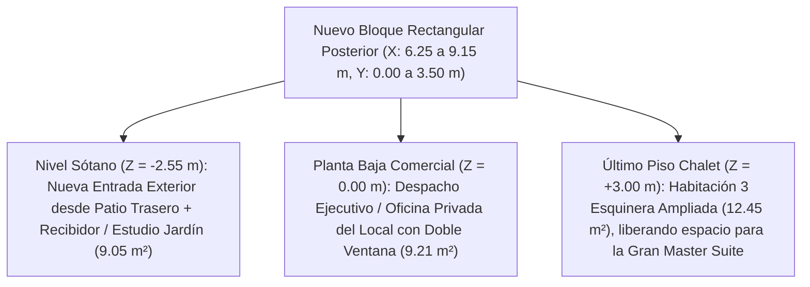

# Plan de Rediseño Mejorado: Estilo Chalet Rústico & Ampliación Rectangular Integral
**Proyecto Residencial y Comercial — Municipio Independencia, Yaracuy**  
**Modelo Base de Partida:** [`casa_nuevo_proyecto.dxf`](file:///c:/Users/alvar/Documents/casa/02_Modelos_CAD/casa_nuevo_proyecto.dxf) *(copia de `casa_modificaciones.dxf` con Opción A del estacionamiento de `3,00 m` libres ya aplicada)*

---

## 🏔️ 1. Visión Arquitectónica y Mejoras Clave del Rediseño

Esta versión mejorada del **Plan Rediseño Chalet Rústico** perfecciona la propuesta alpina original resolviendo de raíz las condicionantes reales de medianería, topografía, confort espacial y regularidad estructural del lote:

1. **Respeto Absoluto al Vecino Izquierdo (`X = 0,00..0,15 m`):** Se elimina cualquier invasión aérea o descarga pluvial hacia el lindero oeste (*Casa de Mario Graterol*). El muro propio izquierdo (`X = 0,15..0,30 m`) actúa como **muro ciego cortafuegos con alero cero (`0,00 m`) y canalón pluvial oculto interno**, mientras los grandes aleros alpinos con vigas pasantes (*rafter tails*) se despliegan hacia nuestros retiros propios (Este y Sur) y fachada frontal.
2. **Regularización Rectangular Completa (`9,00 × 21,71 m`) en los 3 Niveles:** Se elimina el recorte posterior derecho (`X = 6,25..9,15 m`, `Y_casa = 0,00..3,50 m`), propagando un nuevo módulo estructural desde el **Sótano** hasta el **Último Piso** (`+9,6 m²` por nivel) y cerrando la retícula con una nueva columna esquinera en `(9,075, 0,075)`.
3. **Doble Acceso al Sótano (Exterior por Patio Trasero + Escalera Interior Intacta):** Aprovechando que el patio trasero (`3,00 m` de fondo) está al mismo nivel `Z = -2,55 m` del sótano y se comunica con la calle por la rampa/escalinata del retiro lateral derecho, el nuevo módulo del sótano incorpora la **entrada exterior principal desde el patio trasero** hacia un recibidor-estudio luminoso, conservando intacta la escalera interior desde el garaje.
4. **Master Suite Chalet de Gran Formato (`32,88 m²` integrados):** Tomando espacio de la antigua Habitación 2 y desplazando las habitaciones secundarias hacia el nuevo bloque posterior, la Suite Principal pasa a contar con:
   - **Terraza Privada Techada exclusiva (`3,00 × 1,96 m = 5,88 m²`)** independiente de la balconada social.
   - **Dormitorio Principal amplio (`3,00 × 4,50 m = 13,50 m²`)**.
   - **Vestier Walk-In verdadero de doble frente (`3,00 × 2,20 m = 6,60 m²`)**.
   - **Baño En-Suite tipo Spa (`3,00 × 2,30 m = 6,90 m²`)** con doble lavamanos, ducha de piedra y ventilación natural.
5. **Gran Salón Rústico Sin Chimenea:** Espacio social más amplio, fresco y fluido bajo cerchas de madera vistas, conectado a su propia **Gran Balconada Rústica Social (`5,55 × 1,96 m = 10,88 m²`)**.

> [!IMPORTANT]
> **Cero Invasión de Linderos:** Ningún elemento constructivo, cornisa, contraventana ni goterón sobrepasa `X = 0,15 m` hacia el vecino izquierdo, ni invade la vía pública en Avenida 4 (`Y_casa = 21,71 m`). Los voladizos rústicos Este (`0,95 m`) y Sur (`1,00 m`) quedan 100% dentro del terreno propio.

---

## 🏗️ 2. Solución de Cubierta Chalet frente a la Medianera Izquierda

Para conservar la estética de **Chalet Alpino a Dos Aguas** sin verter aguas ni invadir al vecino izquierdo, se adopta una **cubierta a dos aguas con encuentro en parapeto-canalón medianero oculto**:



- **Lado Izquierdo (`X = 0,15 m`):** Muro propio elevado hasta `Z = +6,25 m` con albardilla impermeable inclinada hacia adentro y pesebrón metálico oculto de gran sección (`25 × 20 cm`). Cero humedad y cero servidumbre de aguas hacia el vecino.
- **Lado Derecho (`X = 9,15 m`):** Alero volado de `0,95 m` con pares y canecillos de madera vistos (*rafter tails*), dejando libre `0,70 m` a `1,27 m` adicionales dentro de nuestro propio retiro lateral derecho.
- **Fachada Sur Posterior (`Y_casa = 0,00 m`):** Alero volado de `1,00 m` sobre el patio trasero propio (`3,00 m` de fondo), protegiendo de lluvia y sol tanto los ventanales superiores como la **nueva puerta exterior del sótano**.
- **Fachada Norte Avenida 4 (`Y_casa = 21,71 m`):** Galería frontal empotrada bajo el gran hastial triangular de la cubierta alpina con cercha monumental de madera vista (*King-Post Truss*), protegiendo ambas terrazas sin invadir el espacio público.

---

## 📐 3. Aprovechamiento del Nuevo Bloque Rectangular por Nivel (`9,00 × 21,71 m`)

Al completar la esquina posterior derecha (`X = 6,25..9,15 m`, `Y_casa = 0,00..3,50 m`) y añadir la **Columna 32** en `(X = 9,075 m, Y_casa = 0,075 m)`, la edificación alcanza una planta rectangular pura de **`195,39 m²` brutos por nivel**:



### 3.1. Nivel Sótano (`Z = -2,55 m`) — Doble Acceso (Interior + Patio Trasero)
- **Conservación:** Se mantienen intactos la **escalera interior actual** (`ESCALERA_3D` en `X = 0,30..1,40 m`), las 8 columnas originales de `35 × 35 cm` (más la nueva columna esquinera posterior de `35 × 35 cm`), Cocina, Comedor, Habitación 1, Lavadero y Baño.
- **Nuevo Espacio Posterior (`X = 6,25..8,95 m`, `Y_casa = 0,15..3,50 m` → `2,70 × 3,35 m = 9,05 m²`):**
  - **Entrada Exterior Principal por el Patio Trasero:** Puerta rústica de madera y vidrio (`1,10 × 2,05 m` en `Y_casa = 0,00 m`, `X = 7,60..8,70 m`) + ventanal lateral (`X = 6,45..7,40 m`) a nivel llano con el patio posterior (`Z = -2,55 m`), conectada directamente a la calle mediante la caminería/rampa del retiro lateral derecho.
  - **Recibidor Social & Estudio Jardín:** Se integra mediante un amplio vano/arco en `Y_casa = 3,50 m` con la **Sala del Sótano** (`2,95 × 4,50 m`), conformando un eje social continuo de `8,00 m` de largo, y añade paso lateral en `X = 6,25 m` hacia el pasillo del baño y comedor.
  - **Mejora sanitaria:** El Baño del Sótano (`X = 4,75..6,25 m`) recibe ahora ventilación natural directa a través del muro sur (`Y_casa = 0,00..0,15 m`) hacia el patio trasero.

### 3.2. Planta Baja Comercial y Garaje (`Z = 0,00 m`)
- **Garaje Doble Conservando Columnas Existentes ("Bolsillos de `3,00 m`"):** Se mantienen el **100% de las columnas existentes en su sitio original** (`Eje 0 = 0,275 m` y `Eje 1 = 2,825 m`), retranqueando únicamente el muro divisorio no estructural a `X = 3,30..3,45 m`. Esto crea **bolsillos de `3,00 m` de pared a pared** en los amplios vanos entre columnas (`4,05 m`, `2,90 m` y `2,76 m`) para abrir cómodamente las puertas de ambos vehículos sin demoler ni recalzar estructura, con portón de `2,30 × 2,40 m` entre las columnas frontales `A0` y puerta posterior directa al arranque de ambas escaleras intactas (`ESCALERA_3D` y `P2_ESCALERA_3D`).
- **Gran Salón Comercial (`5,55 × 16,16 m = 89,7 m²`) y Baño del Local (`3,00 × 1,75 m`):** 100% preservados.
- **Nuevo Espacio Posterior (`X = 6,40..9,00 m`, `Y_casa = 0,15..3,50 m` → `2,60 × 3,35 m = 8,71 a 9,21 m²`):**
  - **Oficina Privada de Gerencia / Administración:** Conectada desde el área de depósito/oficina trasera (`X = 2,90..6,25 m`) mediante puerta en `X = 6,25..6,40 m` (`Y_casa = 1,25..2,15 m`), sin interferir con el Baño del Local ubicado en `Y_casa = 3,65..5,40 m`. Disfruta de iluminación y ventilación cruzada Este–Sur.

---

## 🏡 4. Nueva Distribución Detallada del Último Piso Chalet (`Z = +3,00 m`)

La planta alta (`9,00 × 21,71 m`) se organiza en dos crujías longitudinales separadas por el `Eje 2` (`X = 5,85..6,00 m`), logrando ventilación cruzada Norte–Sur, separación clara entre área social y privada, y una **Master Suite de jerarquía superior**:

```
                          AVENIDA 4 (FACHADA NORTE — Y = 21,71 m)
  Vecino    ┌───────────────────────────────────┬───────────────────────────────┐  Retiro
  Izquierdo │ GRAN BALCONADA RÚSTICA SOCIAL     │ TERRAZA PRIVADA MASTER SUITE  │  Lateral
  (X<0,15)  │ Techada con Cruz de San Andrés    │ Exclusiva e independiente     │  Propio
  SIN ALERO │ (5,55 x 1,96 m = 10,88 m²)        │ (3,00 x 1,96 m = 5,88 m²)     │  con Alero
     ║      ├───────────────────────────────────┼───────────────────────────────┤  de 0,95 m
     ║      │                                   │                               │    │
     ║      │ GRAN SALÓN - COMEDOR ALPINO       │ DORMITORIO MASTER SUITE       │    │
     ║ Muro │ (Sin chimenea — máxima amplitud)  │ (3,00 x 4,50 m = 13,50 m²)    │    │
     ║ Ciego│ - Cerchas de madera vistas        │ - Cama King + Ventanal Este   │    │
     ║ Pro- │ - Pilares Timber Frame integrados │ - Salida a Terraza Privada    │    │
     ║ pio  │ (5,55 x 6,25 m = 34,69 m²)        ├─────────────── ── ────────────┤    │
     ║ +    │                                   │ GRAN VESTIER WALK-IN          │    │
     ║ Cana-├ ─ ─ ─ ─ ─ ─ ─ ─ ─ ─ ─ ─ ─ ─ ─ ─ ─ ┤ Doble frente (3,00 x 2,20 m)  │    │
     ║ lón  │                                   ├─────────────── ── ────────────┤    │
     ║ Ocul-│ COCINA RÚSTICA DE MONTAÑA         │ GRAN BAÑO EN-SUITE SPA        │    │
     ║ to   │ - Mesón en L sobre muro ciego     │ Doble lavamanos + Ducha laja  │    │
     ║      │ - Isla maciza central (2,60x0,95) │ (3,00 x 2,30 m = 6,90 m²)     │    │
     ║      │ (5,55 x 5,70 m = 31,64 m²)        ├───────────────────────────────┤    │
     ║      │                                   │ HABITACIÓN 2 (Reubicada)      │    │
     ║      ├───────────────────┬───────────────┤ - Closet madera + Ventana Este│    │
     ║      │ CAJA DE ESCALERAS │ VESTÍBULO     │ (3,00 x 3,55 m = 10,65 m²)    │    │
     ║      │ Intacta (2,35x2,95│ DISTRIBUIDOR  ├───────────────────────────────┤    │
     ║      │ sube 7,35 -> 4,40)│ (3,05 x 2,95) │ BAÑO FAMILIAR COMPARTIDO      │    │
     ║      ├───────────────────┼───────────────┤ (3,00 x 1,85 m = 5,55 m²)     │    │
     ║      │ LAVANDERÍA RÚSTICA│ ESTAR / MIRA- ├───────────────────────────────┤    │
     ║      │ TECHADA           │ DOR POSTERIOR │ HABITACIÓN 3 (Nuevo Bloque)   │    │
     ║      │ Ventilación al Sur│ Vista a patio │ Esquinera Este-Sur ampliada   │    │
     ║      │ (2,45 x 4,10 m)   │ (2,95 x 3,35) │ (3,00 x 4,15 m = 12,45 m²)    │    │
     ║      └───────────────────┴───────────────┴───────────────────────────────┘    │
                          PATIO TRASERO PROPIO (SUR — Y = 0,00 m, Alero = 1,00 m)
```

### Cuadro Exacto de Áreas y Cotas del Último Piso (`Y_casa = 0,00` a `21,71 m`)

| Ambiente (Planta Alta Chalet) | Rango `X` libre (m) | Rango `Y_casa` libre (m) | Dimensiones Libres | Área Útil | Mejora frente al Plan Original |
| :--- | :---: | :---: | :---: | :---: | :--- |
| **Gran Balconada Social Techada** | `0,30 .. 5,85` | `19,60 .. 21,56` | `5,55 × 1,96 m` | `10,88 m²` | Más profunda (`1,96 m` vs `1,60 m`) y separada de la Suite |
| **Terraza Privada Master Suite** | `6,00 .. 9,00` | `19,60 .. 21,56` | `3,00 × 1,96 m` | `5,88 m²` | **100% privada** con muro/celosía divisoria en `Eje 2` |
| **Dormitorio Master Suite** | `6,00 .. 9,00` | `14,95 .. 19,45` | `3,00 × 4,50 m` | `13,50 m²` | Acceso protegido sin vista directa a la cama desde el salón |
| **Vestier Walk-In Master Suite** | `6,00 .. 9,00` | `12,60 .. 14,80` | `3,00 × 2,20 m` | `6,60 m²` | **+260% más amplio**: doble hilera de closets + pasillo central |
| **Baño En-Suite Spa Master** | `6,00 .. 9,00` | `10,15 .. 12,45` | `3,00 × 2,30 m` | `6,90 m²` | **+80% más amplio**: doble lavamanos, gran ducha y ventana Este |
| **Habitación Secundaria 2** | `6,00 .. 9,00` | `6,45 .. 10,00` | `3,00 × 3,55 m` | `10,65 m²` | Conserva amplitud óptima desplazándose hacia el sur |
| **Baño Familiar Compartido** | `6,00 .. 9,00` | `4,45 .. 6,30` | `3,00 × 1,85 m` | `5,55 m²` | Ubicado estratégicamente entre Hab. 2, Hab. 3 y escalera |
| **Habitación 3 (Nuevo Bloque)** | `6,00 .. 9,00` | `0,15 .. 4,30` | `3,00 × 4,15 m` | `12,45 m²` | **+28% más grande**, esquinera con doble ventana Este y Sur |
| **Gran Salón - Comedor Alpino** | `0,30 .. 5,85` | `13,20 .. 19,45` | `5,55 × 6,25 m` | `34,69 m²` | **Sin chimenea**: diáfano, fresco y con cerchas vistas |
| **Cocina Rústica + Isla Central** | `0,30 .. 5,85` | `7,50 .. 13,20` | `5,55 × 5,70 m` | `31,64 m²` | Aprovecha muro ciego izquierdo + isla maciza de `2,60 × 0,95 m` |
| **Escalera + Vestíbulo P2** | `0,30 .. 5,85` | `4,40 .. 7,35` | `5,55 × 2,95 m` | `16,37 m²` | Escalera intacta con baranda rústica en Cruz de San Andrés |
| **Estar / Estudio Mirador Sur** | `2,90 .. 5,85` | `0,15 .. 3,50` | `2,95 × 3,35 m` | `9,88 m²` | Mirador ventilado que da paso limpio a Hab. 3 (evitando col. `G`) |
| **Lavandería Rústica Techada** | `0,30 .. 2,75` | `0,15 .. 4,25` | `2,45 × 4,10 m` | `10,05 m²` | Ventilación natural directa hacia el patio posterior |

> [!TIP]
> **Integración Estructural + Estética Chalet:** Las columnas existentes de `25 × 25 cm` en `Eje 1` (`X = 2,825 m`) suben intactas al último piso revestidas en madera noble (*Timber Frame Posts*): quedan ocultas en lavandería y baranda de escalera (`G`, `F`), nacen integradas en la esquina de la Isla Central de Cocina (`D`), marcan el paso entre sala y comedor bajo una viga maestra longitudinal (`B`, `A`) y coronan como poste maestro frontal de la Balconada Social (`A0`).

---

## 🌲 5. Canon Estético, Materiales y Parámetros CAD

| Componente | Especificación Rústica Mejorada | Dimensión / Cota |
| :--- | :--- | :--- |
| **Zócalo Planta Baja y Sótano** | Mampostería rústica de piedra natural / laja sobre muros estructurales | `e = 0,15 a 0,25 m` |
| **Cerramientos Planta Alta** | Entramado de madera vista (*Timber Frame*) y tablones machihembrados | `e = 0,15 a 0,20 m` |
| **Cubierta Alpina a Dos Aguas** | Pendiente `32°` con teja rústica/pizarra y cerchas interiores expuestas | Cumbrera `Z ≈ +8,75 m` |
| **Alero Izquierdo (Oeste)** | **Cero voladizo (`0,00 m`)** + parapeto cortafuegos y canalón interno oculto | Enrasado en `X = 0,15 m` |
| **Alero Derecho (Este) y Sur** | Voladizos propios con vigas y canecillos vistos (*rafter tails* `10 × 15 cm`) | `0,95 m` (Este) / `1,00 m` (Sur) |
| **Balconada y Terraza Suite** | Barandilla alpina en **Cruz de San Andrés** + tabique divisorio de privacidad | Profundidad libre `1,96 m` |
| **Carpintería Exterior** | Ventanales de madera con cuarterones y contraventanas (*shutters*) en Este y Sur | Cero vanos en muro Oeste |

---

## 📋 6. Hoja de Ruta Ejecutada sobre `casa_nuevo_proyecto.dxf` — 100% COMPLETADO ✅

Siguiendo la metodología acordada (manteniendo [`casa_modificaciones.dxf`](file:///c:/Users/alvar/Documents/casa/02_Modelos_CAD/casa_modificaciones.dxf) 100% intacto):

1. **Paso 1 — Estacionamiento Ampliado Conservando Columnas Existentes:** ✅ **Completado** en [`casa_nuevo_proyecto.dxf`](file:///c:/Users/alvar/Documents/casa/02_Modelos_CAD/casa_nuevo_proyecto.dxf) (28 columnas originales intactas + muro retranqueado en `X = 3,30..3,45 m` con bolsillos de `3,00 m` para abrir puertas).
2. **Paso 2 — Ampliación Rectangular Posterior + Nueva Entrada Exterior al Sótano:** ✅ **Completado**
   - Extendidos losa, muros y Columna 32 esquinera en `X = 6,25..9,15 m`, `Y_casa = 0,00..3,50 m` desde Sótano hasta P2.
   - Incorporados en Sótano la puerta exterior rústica (`1,10 × 2,05 m`) y ventanal hacia el patio trasero (`Y_casa = 0,00 m`), el recibidor-estudio integrado con la Sala, la ventilación sur directa del baño del sótano, y en PB la nueva Oficina Privada de Gerencia.
3. **Paso 3 — Nueva Distribución Interior del Último Piso (Master Suite Ampliada + 2 Terrazas + Sin Chimenea):** ✅ **Completado**
   - Modelada la nueva tabiquería de P2: Terraza Privada Master Suite (`5,88 m²`) separada de la Balconada Social (`10,88 m²`), Dormitorio Master (`13,50 m²`), Vestier Walk-In con doble hilera de closets (`6,60 m²`), Baño Spa (`6,90 m²`), Habitación 2 (`10,65 m²`), Baño Familiar (`5,55 m²`), Habitación 3 esquinera (`12,45 m²`) y Gran Salón-Cocina sin chimenea.
4. **Paso 4 — Envolvente y Cubierta Chalet Rústico Respetando Colindancia Izquierda:** ✅ **Completado**
   - Modelada en 3D la cubierta alpina a dos aguas (`32°`, cumbrera en `X = 4,85 m`, `Z = +8,70 m`) con alero cero (`0,00 m`) y parapeto-canalón oculto en `X = 0,15..0,55 m` (`0` invasiones hacia `X < 0,15 m`), aleros con canecillos vistos en Este (`0,95 m`) y Sur (`1,00 m`), cerchas vistas (*King-Post Trusses*), barandillas en Cruz de San Andrés, carpinterías con cuarterones/*shutters* y láminas 2D actualizadas en [`build_nuevo_proyecto.py`](file:///c:/Users/alvar/Documents/casa/04_Scripts_Parametricos/build_nuevo_proyecto.py).
